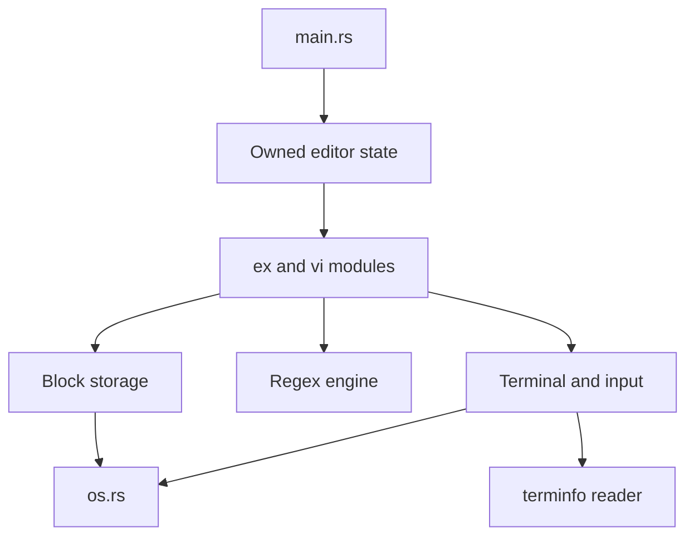

# Elvis-tiny Rust port: implementation guide

This guide tells a future implementer (human or LLM) exactly how to port the
C editor in `elvis-tiny-c/` to Rust in this repository. It is self-contained:
read it fully before writing code, then work through the milestones in order.

Nothing in this guide has been implemented or tested yet. Every command below is
an instruction for future work, not a record of results. All status columns start
as `todo`.

## Contents

1. [Scope and decisions](#1-scope-and-decisions)
2. [Source mapping and port ledger](#2-source-mapping-and-port-ledger)
3. [Ownership and interface rules](#3-ownership-and-interface-rules)
4. [Terminal integration](#4-terminal-integration)
5. [Milestones](#5-milestones)
6. [Testing instructions](#6-testing-instructions)
7. [Validation, release settings, and definition of done](#7-validation-release-settings-and-definition-of-done)
8. [Appendices](#8-appendices)

---

## 1. Scope and decisions

### 1.1 Goal

Port the `elvis` program, as built by the Linux settings in
`elvis-tiny-c/Makefile.mix`, to a Rust binary in this crate that runs on Linux
and macOS. Keep it small,
keep C-to-Rust traceability at file and function level, and keep editor
behavior identical except where the C code has undefined behavior.

### 1.2 Recorded decisions

These decisions are fixed. Do not revisit them without asking the user.

| ID | Decision |
|----|----------|
| D1 | Port exactly the functionality enabled by the current Linux settings in `Makefile.mix`, including `CRUNCH` behavior. Exclude disabled features, other platforms, and separately built utilities. Keep every call the editor makes to external programs (the shell, `echo` for wildcards, the keyword program, filters). |
| D2 | Preserve module and function traceability: `foo.c` maps to `src/foo.rs`, and each active C function maps to a Rust function with the same name. Only ownership, signature, representation, and control-flow changes required for safe Rust are allowed. Refactoring beyond that is deferred. **Revised 2026-11-10 after M8:** idiomatic refactoring is now allowed (moving items between modules, merging modules, methods instead of free functions, typed values instead of C integers and arrays), provided editor behavior and the golden tests are unchanged and the release binary does not grow. Traceability is kept through the `// C: file.c:function` comments, which stay on every function derived from C even when it moves or is renamed. |
| D3 | Dependencies: `std` and `libc` only. No other crates, including dev-dependencies. (Until 2026-11-10 the port also used `terminfo-lean` 0.1.2; section 4.1 explains its replacement.) |
| D4 | All project-owned `unsafe` code and every direct `libc` call live in `src/os.rs`. `os.rs` exposes only safe, sound interfaces. No other module uses `unsafe` or names `libc`. |
| D5 | No `setjmp`/`longjmp` equivalents and no nonlocal jumps across Rust frames. Signals set flags; cancellation and errors travel through return values. |
| D6 | Keep byte-oriented text (never require UTF-8 for file contents, keys, or messages), the block-backed temporary-file storage algorithm, the existing size limits, the undo semantics, and the same-platform temporary-file layout. |
| D7 | Where the C code has undefined behavior (buffer overruns, out-of-range indexing, signed overflow), Rust rejects the operation safely instead of reproducing the bug. Each such case is recorded in the divergence ledger (Appendix B). |
| D8 | Linux and macOS are both supported, development and testing platforms. Both use the same feature flags (the Linux settings in `Makefile.mix`). Section 1.6 lists the platform rules. |

**Supersedes `PLAN.md` on one point.** `PLAN.md` tentatively suggests the
`termini` crate. The user has since approved `terminfo-lean` 0.1.2 instead,
because it provides database lookup, parsing, byte-oriented capabilities, and
parameter expansion. `termini` does not expand parameterized strings such as
cursor addressing. `Cargo.toml` and `Cargo.lock` still list `termini`; milestone
M1 replaces it. Everything else in `PLAN.md` still applies.

### 1.3 Authoritative references and conflict resolution

When sources disagree, use the first one that applies:

1. The decisions in section 1.2 and the safety rules in section 3.
2. Observed behavior of the C reference binary built in M0 on the same host OS
   (Linux or macOS), recorded as golden files.
3. The C source as preprocessed with the active flags (section 1.4).
4. `elvis-tiny-c/doc/*.doc` and `elvis-tiny-c/KNOWN.BUGS`.
5. `PLAN.md` for intent.

If the C source and observed behavior disagree (for example, because of libc or
ncurses behavior), observed behavior wins and the reason is noted in the ledger.
If the C reference behaves differently on Linux and macOS, each platform follows
its own reference (section 1.6).
If a rule here appears impossible to satisfy, stop and ask the user instead of
weakening it.

### 1.4 Active build configuration

The Linux block in `Makefile.mix` is used on both Linux and macOS:

```make
LIBS=   -ltinfo
CFLAGS= -O2 -DM_SYSV -DCRUNCH -DNO_MKEXRC -DNO_CURSORSHAPE -DNO_CHARATTR \
        -DNO_SHOWMODE -DNO_MODELINE -DNO_OPTCOLS -DNO_DIGRAPH -DNO_ABBR \
        -DNO_AT -DNO_SENTENCE -DNO_ERRLIST -DUSE_MKSTEMP -DUSE_SNPRINTF \
        -fsigned-char $(EXTRA_CFLAGS)
PROGS=  elvis
```

`DATE` is not set for Linux, so `cmd1.c` is compiled without `-DDATE`. On macOS
the same flags apply; only `LIBS` and `EXTRA_CFLAGS` are overridden to make the
C reference build (section 1.6).

Derived symbols from `config.h` with `M_SYSV`:

| Symbol | Value | Symbol | Value |
|--------|-------|--------|-------|
| `UNIXV` | 1 | `ANY_UNIX` | 1 |
| `BSD`, `UNIX7`, `MSDOS`, `TOS`, `AMIGA`, `OSK`, `COHERENT`, `MINIX` | 0 | `MICROSOFT`, `TURBOC` | 0 |
| `TMPDIR` | `"/tmp"` | `TMPNAME` | `"%s/elv%x%04llx%03llx"` |
| `CUTNAME` | `"%s/elv_%04x%03x"` | `SCRATCHOUT` | `"%s/soXXXXXX"` |
| `EXRC`, `HMEXRC` | `".exrc"` | `EXINIT` | `"EXINIT"` |
| `SHELL` | `"/bin/sh"` | `KEYWORDPRG` | `"ref"` |
| `TAGS` | `"tags"` | `REDIRECT` | `"2>"` |
| `SLASH` | `'/'` | `NEEDSYNC` | `FALSE` |
| `FILEPERMS` | `0666` | `MAXMAPS` | 20 |

Features that remain **enabled** because their `NO_*` flag is not set:
`NO_EXTENSIONS`, `NO_RECYCLE`, `NO_MAGIC`, `NO_CHARSEARCH`, and `NO_SHOWMATCH`
are all undefined, so extensions, block recycling, `magic`, `f`/`t`/`;`/`,`
searches, and `showmatch` are part of the port. `DEBUG`, `TRACE`, `lint`,
`CS_IBMPC`, `CS_LATIN1`, and `CS_SPECIAL` are undefined or zero.

Host-dependent symbols (confirm on each OS in M0): `TIOCGWINSZ`, `SIGWINCH`,
`SIGQUIT`, `VSUSP`, `VLNEXT`, and `O_APPEND` are defined on both Linux and
macOS. `__linux__` is defined only on Linux; its only use is the
`<sys/ioctl.h>` include in `curses.c`, which the macOS build forces with
`-include sys/ioctl.h`, so the active code is the same. `TIOCSLTC`, `VSWTCH`,
and `O_BINARY` are not defined on either system (`vi.h` defines `O_BINARY` as
0), and `TIOCSLTC` appears only in branches that `UNIXV` disables anyway.

`-fsigned-char` makes C `char` signed on every architecture. This matters for
comparisons, arithmetic, and the option arrays (section 3.4).

### 1.5 Exclusions

Excluded from the port:

- Disabled features: `.exrc` generation (`:mkexrc`), cursor shapes, character
  attributes, show-mode, modelines, option columns, digraphs, abbreviations,
  `:@`/`@` cut-buffer execution, sentence motions, and error lists (`:errlist`,
  `:make`, `:cc`).
- Code for other platforms: `pc.c`, `sysdos.c`, `atari.c`, `osk.c`, `osk.h`,
  `tinytcap.c`, `date.c`, `alias.c`, and every non-Unix branch in the active
  files.
- Separately built utilities: `ctags`, `ref`, `virec`, `refont`, `wildcard`,
  `shell`, and the `vi`/`ex`/`view`/`input` aliases. The editor still runs
  external programs by name (`ref` through the `keywordprg` option, `$SHELL`,
  and `echo` through the shell), and still prints the `virec` hint for `-r`.
- Build-only and packaging files: `Elvis.lnk`, `Elvis.mak`, `Elvis.prj`,
  `profile.sh`, and the `install`, `uue`, `sh`, `print`, and `floppy` targets.

The active build has no job-control suspend command: `VSUSP` is cleared in the
terminal settings and no `SIGTSTP` handling is compiled. "Suspend/resume" in
this guide means `suspend_curses()`/`resume_curses()` around shell commands.
Confirm this in M0.

### 1.6 Supported platforms

The port supports **Linux and macOS** equally, and development can happen
directly on either. Both are modern Unix systems, so both use the same feature
flags from section 1.4. The supported targets are Linux on x86_64 and arm64,
and macOS on arm64 and x86_64.

Rules:

- Editor modules contain no platform conditionals. Platform differences live
  only in `os.rs`, which may use `#[cfg(target_os = "linux")]` and
  `#[cfg(target_os = "macos")]`.
- Behavior parity is always measured against the C reference built on the
  **same host OS**. Golden files are stored per OS in `tests/golden/linux/`
  and `tests/golden/macos/`. Where the C reference behaves differently on the
  two systems (usually because of the terminal library or the C library),
  record the difference in `tests/golden/c-behavior.md`; the Rust port follows
  the C reference for that host.
- "Same-platform temporary-file layout" (D6) means the layout produced by the
  C reference on the same OS and architecture.
- Every milestone exit criterion must hold on both Linux and macOS before the
  milestone is complete. A session may work on one OS, but the checkpoint
  (section 7.4) must say which OS was verified, and a milestone stays open
  until the other OS is verified too.

**Building the C reference on macOS.** macOS has no `libtinfo`, and two
headers differ, so the build needs make-variable overrides. These change
neither the feature flags nor any file in `elvis-tiny-c/`:

```sh
# In a copy of elvis-tiny-c/ (never in the original):
mkdir -p shim && printf '#include <stdlib.h>\n' > shim/malloc.h
make -f Makefile.mix elvis LIBS=-lncurses EXTRA_CFLAGS="-include sys/ioctl.h -Ishim"
```

- `LIBS=-lncurses`: the system ncurses library provides the termcap functions.
- `-include sys/ioctl.h`: `curses.c` includes `<sys/ioctl.h>` only under
  `__linux__`, but it needs `ioctl` and `TIOCGWINSZ` on macOS as well.
- `-Ishim` with a one-line `malloc.h`: `tmp.c` includes `<malloc.h>`, which
  macOS does not provide.

A trial build with these overrides succeeded on macOS (Apple clang 21, system
`libncurses.5.4.dylib`), and `elvis -r` ran and exited with status 0. Nothing
else has been tested.

**Known platform differences to handle and verify:**

| Area | Linux | macOS |
|------|-------|-------|
| Terminal library used by C | `libtinfo` (ncurses 6.x) | system `libncurses.5.4.dylib` (old ncurses ABI) |
| Interposition of elvis's `ospeed`/`PC` globals | possible with ELF symbol interposition | normally not, because of two-level namespaces; M0 checks |
| `cfgetospeed` value stored in `short ospeed` | `B*` code (for example `B38400` is 15) | the baud number itself, which can overflow `short` (for example 38400 becomes negative) |
| `st_dev` type | `u64` | `i32` |
| Terminfo database | `/usr/share/terminfo`, `/lib/terminfo`, `/etc/terminfo` | `/usr/share/terminfo` |
| `/dev/full` | available | not available |
| Symbol listing | `nm --defined-only` | `nm -U` |
| Linked libraries | `ldd` | `otool -L` |
| Peak memory | `/usr/bin/time -v` | `/usr/bin/time -l` |
| `unifdef` | install from a package | preinstalled |

---

## 2. Source mapping and port ledger

### 2.1 How the inventory was produced

The function lists below were produced by resolving the active branches with
`unifdef` using the flags in section 1.4, then listing definitions. M0 must
re-verify them on both Linux and macOS against the real preprocessor and the
symbols in an unoptimized C build (section 5, M0). If a function is missing here, add it to
the ledger before porting.

### 2.2 File mapping

| C source | Rust module | Notes |
|----------|-------------|-------|
| `main.c` | `src/main.rs` | Entry point, startup, main loop, `trapint` |
| `config.h` | `src/config.rs` | Constants resolved for the shared Unix settings only |
| `vi.h` | `src/types.rs` | Constants, `Mark` helpers, flag helpers, shared types. Was `vi_h.rs` until the idiomatic-cleanup pass |
| `curses.h`, `curses.c` | `src/curses.rs` | Header macros become methods or functions |
| `regexp.h`, `regexp.c` | `src/regexp.rs` | |
| `vars.c` | `src/vars.rs` | Shared state, plus the `Editor` struct |
| `blk.c` | `src/blk.rs` | |
| `cmd1.c` | `src/cmd1.rs` | |
| `cmd2.c` | `src/cmd2.rs` | |
| `cut.c` | `src/cut.rs` | |
| `ex.c` | `src/ex.rs` | |
| `input.c` | `src/input.rs` | |
| `misc.c` | `src/misc.rs` | |
| `modify.c` | `src/modify.rs` | |
| `move1.c` to `move5.c` | `src/move1.rs` to `src/move5.rs` | |
| `opts.c` | `src/opts.rs` | |
| `recycle.c` | `src/recycle.rs` | |
| `redraw.c` | `src/redraw.rs` | |
| `regsub.c` | `src/regsub.rs` | |
| `system.c` | `src/system.rs` | Editor logic only; process primitives are in `os.rs` |
| `tio.c` | `src/tio.rs` | |
| `tmp.c` | `src/tmp.rs` | |
| `vcmd.c` | `src/vcmd.rs` | |
| `vi.c` | `src/vi.rs` | |
| (new) | `src/os.rs` | The only module with `unsafe` and `libc` |

No other modules may be added except `#[cfg(test)]` test modules inside these
files. A helper needed by several modules goes in the module where C defined it,
or in `vi_h.rs` if it replaces a `vi.h` macro.

### 2.3 Ledger rules

- Every row must reach status `done` (ported and tested) or `excluded` (with a
  reason) before M9 completes.
- Keep the C name. Use `#[allow(non_snake_case)]` on individual items such as
  `m_Nsrch`, `m_Fch`, and `m_Tch` rather than renaming them.
- Macros become `const` items, `#[inline]` functions, or methods. Name them
  after the macro (constants keep upper case; function-like macros become lower
  case, for example `MUSTHAVE` becomes `musthave`).
- Above each ported function, add a single comment `// C: file.c:function` to
  keep traceability.
- File-scope and function-local `static` variables become fields of that
  module's state struct (section 3.1). Name function-local statics
  `<function>_<variable>`, for example `getkey_cooked`.
- Prototypes that are declared in `vi.h` but defined nowhere (`reset_msg`,
  `m_fWord`, `m_bWord`, `m_eWord`, `v_Xchar`, `do_abbr`, `do_digraph`,
  `digraph`, `saveopts`) are not ported. Confirm in M0 that nothing calls them.
- Only the Status column, the "Ported in" column, new rows for items that M0
  finds missing, and the appendices may be edited without user approval.

Column legend: **M** is the milestone that owns the item. A leaf helper may be
ported earlier when a previous milestone needs it; record that in the
"Ported in" column.

### 2.4 Active items

#### `main.c` → `main.rs`

| C item | Kind | M | Ported in | Status |
|--------|------|---|-----------|--------|
| `main` | fn | M6 (startup), M8 (loop) | macOS port 2026-11-10 | done (macOS) |
| `trapint` | fn (signal handler) | M8 | macOS port 2026-11-10 | done (macOS) |
| `jmpenv` | global | M8, replaced by interrupt propagation (section 3.7) | macOS port 2026-11-10 | done (macOS) |

#### `vars.c` → `vars.rs`

| C item | Kind | M | Ported in | Status |
|--------|------|---|-----------|--------|
| `viflags`, `lnum`, `nlines`, `tmpfd`, `origtime`, `origname`, `prevorig`, `prevline`, `mark`, `cursor`, `mode`, `args`, `argno`, `nargs`, `bavar`, `mustredraw`, `changes`, `significant`, `plen`, `pline`, `pchgs`, `ptext`, `tmpblk`, `topline`, `leftcol`, `physcol`, `physrow`, `exwrote`, `doingdot`, `doingglobal`, `rptlines`, `rptlabel`, `U_line`, `U_text` | globals | M1 | M1 | done |

`bavar` exists only for the `BeforeAfter` macro and is not needed in Rust.

#### `config.h` → `config.rs`, `vi.h` → `vi_h.rs`

| C item | Kind | M | Ported in | Status |
|--------|------|---|-----------|--------|
| `ttyread`, `ttywrite`, `tread`, `twrite` | macros | M1 | M1 | done |
| `UCHAR`, `uchar`, `REG`, path and name constants from section 1.4 | macros | M1 | M1 | done |
| `VERSION`, `COPYING`, `INFINITY`, `LONGKEY`, `MAXRCLEN`, `BLKSIZE`, `MAXBLKS`, `NMARKS` | constants | M1 | M1 | done |
| `BLK` union | type | M1 | M1 | done |
| `NEWFILE`, `READONLY`, `HADNUL`, `MODIFIED`, `NOFILE`, `ADDEDNL`; `setflag`, `clrflag`, `tstflag`, `initflags` | flags, macros | M1 | M1 | done |
| `MARK`, `markline`, `markidx`, `MARK_UNSET`, `MARK_FIRST`, `MARK_LAST`, `MARK_AT_LINE`, `buildmark` | type, macros | M1 | M1 | done |
| `botline`, `rightcol`, `ctrl`, `DEFAULT` | macros | M1 | M1 | done |
| `BeforeAfter`, `ChangeText` | control macros | M4 (replaced by an explicit `beforedo`/`afterdo` pair) | macOS port 2026-11-10 | done (macOS) |
| `CMD_*` codes, `CMD` type | constants | M6 | M1 | done |
| `MODE_EX`, `MODE_VI`, `MODE_COLON`, `MODE_QUIT` | constants | M1 | M1 | done |
| `WHEN_VICMD`, `WHEN_VIINP`, `WHEN_VIREP`, `WHEN_EX`, `WHEN_MSG`, `WHEN_INMV` | constants | M7 | M1 | done |
| `o_*` option declarations | globals (defined in `opts.c`) | M6 | macOS port 2026-11-10 | done (macOS) |

#### `curses.h` + `curses.c` → `curses.rs`

| C item | Kind | M | Ported in | Status |
|--------|------|---|-----------|--------|
| `initscr` | fn | M2 | macOS port 2026-11-10 | done (macOS) |
| `endwin` | fn | M2 | macOS port 2026-11-10 | done (macOS) |
| `suspend_curses` | fn | M2 (M8 verifies) | macOS port 2026-11-10 | done (macOS) |
| `resume_curses` | fn | M2 (M8 verifies) | macOS port 2026-11-10 | done (macOS) |
| `lacking` | static fn | M2 | macOS port 2026-11-10 | done (macOS) |
| `starttcap` | static fn | M2 | macOS port 2026-11-10 | done (macOS) |
| `getsize` | static fn and `SIGWINCH` handler | M2 (M8 verifies signal path) | macOS port 2026-11-10 | done (macOS) |
| `faddch` | fn (tputs callback) | M2 | macOS port 2026-11-10 | done (macOS) |
| `qaddstr` | fn | M2 | macOS port 2026-11-10 | done (macOS) |
| `attrset` | fn | M2 | macOS port 2026-11-10 | done (macOS) |
| `insch` | fn | M2 | macOS port 2026-11-10 | done (macOS) |
| `MUSTHAVE`, `MAYHAVE`, `PAIR` | macros | M2 | macOS port 2026-11-10 | done (macOS) |
| `tgoto`, `tputs`, `tgetent`, `tgetstr`, `tgetflag`, `tgetnum` | external termcap functions (`libtinfo` on Linux, `libncurses` on macOS) | M2, replaced by the terminfo reader and adapters in `curses.rs` (section 4) | macOS port 2026-11-10 | done (macOS) |
| `ospeed`, `PC`, `stdscr`, `kbuf`, `LINES`, `COLS`, `AM`, `PT`, capability strings `VB` … `TE`, `aend`, `ERASEKEY`, `oldtermio`, `newtermio`, `capbuf`, `cbmem`, `curses_active` | globals | M2 | macOS port 2026-11-10 | done (macOS) |
| `do_VB` … `do_aend` (all `do_*`) | macros | M2 | macOS port 2026-11-10 | done (macOS) |
| `has_*` | macros | M2 | macOS port 2026-11-10 | done (macOS) |
| `qaddch`, `addch`, `_addCR`, `addstr`, `move`, `mvaddch`, `refresh`, `wrefresh`, `wqrefresh`, `standout`, `standend`, `clrtoeol`, `clrtobot`, `insertln`, `deleteln`, `delch` | macros | M2 | macOS port 2026-11-10 | done (macOS) |
| `scrollok`, `raw`, `echo`, `cbreak`, `noraw`, `noecho`, `nocbreak` | no-op macros | M2 (omit calls; note in comment) | macOS port 2026-11-10 | done (macOS) |
| `CHECKBIOS`, `VOIDBIOS`, `KBSIZ`, `A_*` | macros, constants | M2 | macOS port 2026-11-10 | done (macOS) |

#### `blk.c` → `blk.rs`

| C item | Kind | M | Ported in | Status |
|--------|------|---|-----------|--------|
| `blkinit` | fn | M3 | macOS port 2026-11-10 | done (macOS) |
| `blkget` | fn | M3 | macOS port 2026-11-10 | done (macOS) |
| `blkflush` | fn | M3 | macOS port 2026-11-10 | done (macOS) |
| `blkdirty` | fn | M3 | macOS port 2026-11-10 | done (macOS) |
| `blkadd` | fn | M3 | macOS port 2026-11-10 | done (macOS) |
| `blksync` | fn | M3 | macOS port 2026-11-10 | done (macOS) |
| `beforedo` | fn | M4 | macOS port 2026-11-10 | done (macOS) |
| `afterdo` | fn | M4 | macOS port 2026-11-10 | done (macOS) |
| `abortdo` | fn | M4 | macOS port 2026-11-10 | done (macOS) |
| `undo` | fn | M4 | macOS port 2026-11-10 | done (macOS) |
| `NBUFS` (5), `hdr`, `b4cnt`, `blk[]`, `toonew`, `newtoo`, `recycle`, `undocurs`, `oldnlines`, `oldlnum` | constant, globals | M3/M4 | macOS port 2026-11-10 | done (macOS) |

#### `recycle.c` → `recycle.rs`

| C item | Kind | M | Ported in | Status |
|--------|------|---|-----------|--------|
| `garbage` | fn | M3 | macOS port 2026-11-10 | done (macOS) |
| `allocate` | fn | M3 | macOS port 2026-11-10 | done (macOS) |
| `BTST`, `BSET`, `BCLR`, `TST`, `SET`, `CLR`, `MAXBIT`, `bitmap` | macros, global | M3 | macOS port 2026-11-10 | done (macOS) |

#### `tmp.c` → `tmp.rs`

| C item | Kind | M | Ported in | Status |
|--------|------|---|-----------|--------|
| `tmpstart` | fn | M3 | macOS port 2026-11-10 | done (macOS) |
| `tmpsave` | fn | M3 | macOS port 2026-11-10 | done (macOS) |
| `tmpabort` | fn | M3 | macOS port 2026-11-10 | done (macOS) |
| `tmpend` | fn | M3 | macOS port 2026-11-10 | done (macOS) |
| `elvis_access` | fn | M3 | macOS port 2026-11-10 | done (macOS) |
| `FAIL` | macro (fatal exit 9) | M3 | macOS port 2026-11-10 | done (macOS) |
| `tmpname` | global | M3 | macOS port 2026-11-10 | done (macOS) |

#### `misc.c` → `misc.rs`

| C item | Kind | M | Ported in | Status |
|--------|------|---|-----------|--------|
| `fetchline` | fn | M3 | macOS port 2026-11-10 | done (macOS) |
| `pfetch` | fn | M3 | macOS port 2026-11-10 | done (macOS) |
| `regerror` | fn | M5 | macOS port 2026-11-10 | done (macOS) |
| `nextline`, `chglevel`, `nextscan`, `nextlnum` | statics | M3 | macOS port 2026-11-10 | done (macOS) |
| `buf` (fetchline-local `static BLK`, found by M0) | static | M3 | macOS port 2026-11-10 | done (macOS) |

#### `modify.c` → `modify.rs`

| C item | Kind | M | Ported in | Status |
|--------|------|---|-----------|--------|
| `delete` | fn | M4 | macOS port 2026-11-10 | done (macOS) |
| `add` | fn | M4 | macOS port 2026-11-10 | done (macOS) |
| `change` | fn | M4 | macOS port 2026-11-10 | done (macOS) |

#### `cut.c` → `cut.rs`

| C item | Kind | M | Ported in | Status |
|--------|------|---|-----------|--------|
| `cutneeds` | fn | M4 | macOS port 2026-11-10 | done (macOS) |
| `cutfree` | static fn | M4 | macOS port 2026-11-10 | done (macOS) |
| `cutswitch` | fn | M4 | macOS port 2026-11-10 | done (macOS) |
| `cutend` | fn | M4 | macOS port 2026-11-10 | done (macOS) |
| `cutname` | fn | M4 | macOS port 2026-11-10 | done (macOS) |
| `cut` | fn | M4 | macOS port 2026-11-10 | done (macOS) |
| `readcutblk` | static fn | M4 | macOS port 2026-11-10 | done (macOS) |
| `paste` | fn | M4 | macOS port 2026-11-10 | done (macOS) |
| `NANNONS`, `struct cutbuf`, `named[27]`, `annon[NANNONS]`, `cbname` | constant, type, globals | M4 | macOS port 2026-11-10 | done (macOS) |

#### `regexp.c` → `regexp.rs`, `regsub.c` → `regsub.rs`

| C item | Kind | M | Ported in | Status |
|--------|------|---|-----------|--------|
| `makeclass` | static fn | M5 | macOS port 2026-11-10 | done (macOS) |
| `gettoken` | static fn | M5 | macOS port 2026-11-10 | done (macOS) |
| `calcsize` | static fn | M5 | macOS port 2026-11-10 | done (macOS) |
| `regcomp` | fn | M5 | macOS port 2026-11-10 | done (macOS) |
| `match1` | fn | M5 | macOS port 2026-11-10 | done (macOS) |
| `match` | fn | M5 | macOS port 2026-11-10 | done (macOS) |
| `regexec` | fn | M5 | macOS port 2026-11-10 | done (macOS) |
| `regsub` | fn | M5 | macOS port 2026-11-10 | done (macOS) |
| `META`, `BASE_META`, `INT_META`, `IS_META`, `IS_CLASS`, `IS_START`, `IS_END`, `IS_CLOSURE`, `ADD_META`, `GET_META`, `M_BEGLINE`, `M_ENDLINE`, `M_BEGWORD`, `M_ENDWORD`, `M_ANY`, `M_SPLAT`, `M_PLUS`, `M_QMARK`, `M_CLASS`, `M_START`, `M_END`, `FAIL` | macros | M5 | macOS port 2026-11-10 | done (macOS) |
| `NSUBEXP` (10), `struct regexp` | constant, type | M5 | macOS port 2026-11-10 | done (macOS) |
| `previous` (regexp.c), `class_cnt`, `start_cnt`, `end_stk`, `end_sp`, `retext`, `errorhandler`; `previous` (regsub.c) | globals | M5 | macOS port 2026-11-10 | done (macOS) |

#### `opts.c` → `opts.rs`

| C item | Kind | M | Ported in | Status |
|--------|------|---|-----------|--------|
| `initopts` | fn | M6 | macOS port 2026-11-10 | done (macOS) |
| `dumpopts` | fn | M6 | macOS port 2026-11-10 | done (macOS) |
| `setopts` | fn | M6 | macOS port 2026-11-10 | done (macOS) |
| `MAXWIDTH`, `BOOL`, `NUM`, `STR`, `SET`, `CANSET`, `RCSET`, `MR`, option table | macros, table | M6 | macOS port 2026-11-10 | done (macOS) |
| `o_autoindent` … `o_wrapscan` (all 30 option arrays) | globals | M6 (defaults needed from M1) | M1 (defaults); rest 2026-11-10 | done (macOS) |

#### `ex.c` → `ex.rs`

| C item | Kind | M | Ported in | Status |
|--------|------|---|-----------|--------|
| `parseptrn` | fn | M6 | macOS port 2026-11-10 | done (macOS) |
| `linespec` | fn | M6 | macOS port 2026-11-10 | done (macOS) |
| `ex` | fn | M6 | macOS port 2026-11-10 | done (macOS) |
| `doexcmd` | fn | M6 | macOS port 2026-11-10 | done (macOS) |
| `doexrc` | fn | M6 | macOS port 2026-11-10 | done (macOS) |
| `exstring` | fn | M6 | macOS port 2026-11-10 | done (macOS) |
| `ARGT`, `FROM`, `TO`, `BANG`, `EXTRA`, `XFILE`, `NOSPC`, `DFLALL`, `DFLNONE`, `NODFL`, `EXRCOK`, `NL`, `PLUS`, `ZERO`, `FILES`, `WORD1`, `FILE1`, `NAMEDF`, `NAMEDFS`, `RANGE`, `NONE`, `isascii` | type, macros | M6 | macOS port 2026-11-10 | done (macOS) |
| `cmdnames[]` table (order is significant for abbreviations), `oldline` | table, static | M6 | macOS port 2026-11-10 | done (macOS) |

#### `cmd1.c` → `cmd1.rs`

| C item | Kind | M | Ported in | Status |
|--------|------|---|-----------|--------|
| `cmd_mark` | fn | M6 | macOS port 2026-11-10 | done (macOS) |
| `cmd_write` | fn | M6 | macOS port 2026-11-10 | done (macOS) |
| `cmd_write2` | fn | M6 | macOS port 2026-11-10 | done (macOS) |
| `cmd_shell` | fn | M6 | macOS port 2026-11-10 | done (macOS) |
| `cmd_global` | fn | M6 | macOS port 2026-11-10 | done (macOS) |
| `cmd_file` | fn | M6 | macOS port 2026-11-10 | done (macOS) |
| `cmd_edit` | fn | M6 | macOS port 2026-11-10 | done (macOS) |
| `cmd_next` | fn | M6 | macOS port 2026-11-10 | done (macOS) |
| `cmd_xit` | fn | M6 | macOS port 2026-11-10 | done (macOS) |
| `cmd_args` | fn | M6 | macOS port 2026-11-10 | done (macOS) |
| `cmd_cd` | fn | M6 | macOS port 2026-11-10 | done (macOS) |
| `cmd_map` | fn | M6 | macOS port 2026-11-10 | done (macOS) |
| `cmd_set` | fn | M6 | macOS port 2026-11-10 | done (macOS) |
| `cmd_tag` | fn | M6 | macOS port 2026-11-10 | done (macOS) |
| `cmd_visual` | fn | M6 | macOS port 2026-11-10 | done (macOS) |
| `cmd_version` | fn | M6 | macOS port 2026-11-10 | done (macOS) |
| `prevextra`, `whenwarned`, `prevtag` | function-local statics | M6 | macOS port 2026-11-10 | done (macOS) |

#### `cmd2.c` → `cmd2.rs`

| C item | Kind | M | Ported in | Status |
|--------|------|---|-----------|--------|
| `cmd_substitute` | fn | M6 | macOS port 2026-11-10 | done (macOS) |
| `cmd_delete` | fn | M6 | macOS port 2026-11-10 | done (macOS) |
| `cmd_append` | fn | M6 | macOS port 2026-11-10 | done (macOS) |
| `cmd_put` | fn | M6 | macOS port 2026-11-10 | done (macOS) |
| `cmd_join` | fn | M6 | macOS port 2026-11-10 | done (macOS) |
| `cmd_shift` | fn | M6 | macOS port 2026-11-10 | done (macOS) |
| `cmd_read` | fn | M6 | macOS port 2026-11-10 | done (macOS) |
| `cmd_undo` | fn | M6 | macOS port 2026-11-10 | done (macOS) |
| `cmd_print` | fn | M6 | macOS port 2026-11-10 | done (macOS) |
| `cmd_move` | fn | M6 | macOS port 2026-11-10 | done (macOS) |
| `cmd_source` | fn | M6 | macOS port 2026-11-10 | done (macOS) |
| `optp`, `optg`, `optc` | statics | M6 | macOS port 2026-11-10 | done (macOS) |

#### `system.c` → `system.rs`

| C item | Kind | M | Ported in | Status |
|--------|------|---|-----------|--------|
| `elvis_system` | fn | M6 | macOS port 2026-11-10 | done (macOS) |
| `rpipe` | static fn | M6 | macOS port 2026-11-10 | done (macOS) |
| `rpclose` | static fn | M6 | macOS port 2026-11-10 | done (macOS) |
| `wildcard` | fn | M6 | macOS port 2026-11-10 | done (macOS) |
| `filter` | fn | M6 | macOS port 2026-11-10 | done (macOS) |
| `PROG`, `PROGLEN`, `environ` | macros, extern | M6 | macOS port 2026-11-10 | done (macOS) |

#### `tio.c` → `tio.rs`

| C item | Kind | M | Ported in | Status |
|--------|------|---|-----------|--------|
| `vgets` | fn | M7 | macOS port 2026-11-10 | done (macOS) |
| `beep` | fn | M7 | macOS port 2026-11-10 | done (macOS) |
| `showmsg` | static fn | M7 | macOS port 2026-11-10 | done (macOS) |
| `endmsgs` | fn | M7 | macOS port 2026-11-10 | done (macOS) |
| `msg` | variadic fn | M7 (needed from M3) | macOS port 2026-11-10 | done (macOS) |
| `exrefresh` | fn | M7 (needed from M6) | macOS port 2026-11-10 | done (macOS) |
| `dummy` | static fn (`SIGALRM` handler) | M7, replaced by timed read (section 3.7) | macOS port 2026-11-10 | done (macOS) |
| `getkey` | fn | M7 | macOS port 2026-11-10 | done (macOS) |
| `mapkey` | fn | M7 (needed from M6) | macOS port 2026-11-10 | done (macOS) |
| `dumpkey` | fn | M7 | macOS port 2026-11-10 | done (macOS) |
| `savekeys` | fn | M7 | macOS port 2026-11-10 | done (macOS) |
| `manymsgs`, `pmsg`, `keybuf`, `nkeys`, `next`, `struct _keymap`, `mapped[MAXMAPS]`, getkey statics (`cooked`, `oldwhen`, `oldleft`, `oldtop`, `oldnlines`, `cshape`) | statics | M7 | macOS port 2026-11-10 | done (macOS) |

#### `input.c` → `input.rs`

| C item | Kind | M | Ported in | Status |
|--------|------|---|-----------|--------|
| `input` | fn | M7 | macOS port 2026-11-10 | done (macOS) |

#### `move1.c` … `move5.c` → `move1.rs` … `move5.rs`

| C item | Kind | M | Ported in | Status |
|--------|------|---|-----------|--------|
| `m_updnto`, `m_right`, `m_left`, `m_tocol`, `m_front`, `m_rear`, `m_fparagraph`, `m_bparagraph`, `m_fsection`, `m_bsection`, `m_match`, `m_tomark`, `isascii` (move1.c) | fns, macro | M7 | macOS port 2026-11-10 | done (macOS) |
| `m_nsrch`, `m_Nsrch`, `m_fsrch`, `m_bsrch`, statics `re`, `prevsf` (move2.c) | fns, statics | M7 | macOS port 2026-11-10 | done (macOS) |
| `m__ch`, `m_fch`, `m_Fch`, `m_tch`, `m_Tch`, static `prev_key` (move3.c) | fns, static | M7 | macOS port 2026-11-10 | done (macOS) |
| `prevfwdfn`, `prevrevfn` (move3.c file statics, found by M0) | statics | M7 | macOS port 2026-11-10 | done (macOS) |
| `m_row`, `m_z`, `m_scroll` (move4.c) | fns | M7 | macOS port 2026-11-10 | done (macOS) |
| `m_fword`, `m_bword`, `m_eword`, `isascii` (move5.c) | fns, macro | M7 | macOS port 2026-11-10 | done (macOS) |

#### `vcmd.c` → `vcmd.rs`

| C item | Kind | M | Ported in | Status |
|--------|------|---|-----------|--------|
| `v_quit`, `v_redraw`, `v_1ex`, `v_undo`, `v_xchar`, `v_mark`, `v_ulcase`, `v_replace`, `v_overtype`, `v_selcut`, `v_paste`, `v_yank`, `v_delete`, `v_insert`, `v_change`, `v_subst`, `v_join`, `shift_help` (static), `v_lshift`, `v_rshift`, `v_filter`, `v_status`, `v_again`, `v_switch`, `v_tag`, `v_keyword`, `v_increment`, `v_xit`, `v_undoline` | fns (one row each when tracking; listed together here for brevity) | M7 | macOS port 2026-11-10 | done (macOS) |
| `flip[]`, `width` (v_replace), `sign` (v_increment) | statics | M7 | macOS port 2026-11-10 | done (macOS) |
| M0 note: `width` is local to `v_overtype` (symbol `v_overtype.width`), not `v_replace` | — | M7 | macOS port 2026-11-10 | done (macOS) |

Track each `v_*` function as its own row in the checkpoint log (section 7.4)
when it is ported.

#### `vi.c` → `vi.rs`

| C item | Kind | M | Ported in | Status |
|--------|------|---|-----------|--------|
| `vi` | fn | M7 | macOS port 2026-11-10 | done (macOS) |
| `adjmove` | fn | M7 | macOS port 2026-11-10 | done (macOS) |
| `m_rear_wrapper`, `m_match_wrapper`, `m_front_wrapper` | static fns | M7 | macOS port 2026-11-10 | done (macOS) |
| `struct keystru`, `vikeys[]` table, `NO_FUNC`, `NO_ARGS_F`, `KEYWORD_F`, `CURSOR_F`, `CURSOR_COUNT_F`, `CURSOR_CNT_KEY_F`, `CURSOR_TEXT_F`, `CURSOR_CNT_CMD_F`, `CURSOR_MOVED_F`, `CURSOR_EOL_F`, argument-kind and flag macros (`MVMT`, `PTMV`, `FRNT`, `INCL`, `LNMD`, `NCOL`, `NREL`, `SDOT`, …) | table, macros | M7 | macOS port 2026-11-10 | done (macOS) |
| `colno` (adjmove static) | static | M7 | macOS port 2026-11-10 | done (macOS) |

#### `redraw.c` → `redraw.rs`

| C item | Kind | M | Ported in | Status |
|--------|------|---|-----------|--------|
| `redrawrange` | fn | M8 (needed from M4) | macOS port 2026-11-10 | done (macOS) |
| `idx2col` | fn | M8 (needed from M7) | macOS port 2026-11-10 | done (macOS) |
| `mark2phys` | static fn | M8 | macOS port 2026-11-10 | done (macOS) |
| `drawtext` | static fn | M8 | macOS port 2026-11-10 | done (macOS) |
| `smartdrawtext` | static fn | M8 | macOS port 2026-11-10 | done (macOS) |
| `redraw` | fn | M8 (needed from M6) | macOS port 2026-11-10 | done (macOS) |
| `smartlno`, `redrawafter`, `preredraw`, `postredraw`, redraw statics (`pcursor`, `pcol`, `chgs`), smartdrawtext static `chgs` | statics | M8 | macOS port 2026-11-10 | done (macOS) |
| M0 note: `pcursor`, `pcol`, `chgs` are locals of `idx2col` (redraw.c:88-90); the second `chgs` is local to `redraw` (redraw.c:357); `smartdrawtext` has no static | — | M8 | macOS port 2026-11-10 | done (macOS) |

### 2.5 Excluded items

| C item | File | Reason |
|--------|------|--------|
| `cmd_abbr` | cmd1.c | `NO_ABBR` |
| `cmd_digraph` | cmd1.c | `NO_DIGRAPH` |
| `cmd_errlist`, `cmd_make`, `parse_errmsg` | cmd1.c | `NO_ERRLIST` |
| `cmd_mkexrc` | cmd1.c | `NO_MKEXRC` |
| `cmd_debug`, `cmd_validate` | cmd1.c | `DEBUG` undefined |
| `cmd_at` | cmd2.c | `NO_AT` |
| `gettime`, `ttyread`, `ttywrite`, `alarm`, `sleep`, `TIME` | curses.c | Non-Unix platform code (`TOS`, `MSDOS`, `OSK`) |
| `cb2str` | cut.c | `NO_AT` |
| `rename` macro | cut.c | TOS-only; Linux uses libc `rename` |
| `digraph`, `do_digraph`, `savedigs` | input.c | `NO_DIGRAPH` |
| `do_abbr`, `expandabbr`, `saveabbr` | input.c | `NO_ABBR` |
| `init_digraphs` | main.c | `NO_DIGRAPH` |
| `debout` | modify.c | `DEBUG` undefined |
| `m_fsentence`, `m_bsentence` | move1.c | `NO_SENTENCE` |
| `saveopts` | opts.c | `NO_MKEXRC` |
| `hasattr` | redraw.c | `NO_CHARATTR` |
| `nudgecursor` | redraw.c | `CRUNCH` |
| `reghelp` | regexp.c | Only in the `NO_MAGIC` branch |
| `fromcutbuf` | tio.c | `NO_AT` |
| `do_modeline` | tmp.c | `NO_MODELINE` |
| `sync` | tmp.c | OS-9 only |
| `v_at` | vcmd.c | `NO_AT` |
| `v_errlist` | vcmd.c | `NO_ERRLIST` |
| `watch` | vi.c | `DEBUG` undefined |
| All functions in `alias.c`, `atari.c`, `ctags.c`, `osk.c`, `pc.c`, `ref.c`, `refont.c`, `shell.c`, `sysdos.c`, `tinytcap.c`, `virec.c`, `wildcard.c`, `date.c` | — | Not part of the configured `elvis` build |

Also exclude every branch inside active functions that depends on a disabled
flag. Port only the code that remains after resolving section 1.4.

---

## 3. Ownership and interface rules

### 3.1 Editor state



- `vars.rs` defines `pub struct Editor`, created once in `main` and passed as
  `ed: &mut Editor` to every function that touched C global state.
- `Editor` holds one field per module state struct: `ed.vars` (from `vars.c`),
  `ed.blk`, `ed.recycle`, `ed.tmp`, `ed.misc`, `ed.cut`, `ed.regexp`,
  `ed.regsub`, `ed.opts`, `ed.ex`, `ed.cmd1`, `ed.cmd2`, `ed.curses`, `ed.tio`,
  `ed.move2`, `ed.move3`, `ed.vcmd`, `ed.vi`, and `ed.redraw`. Each struct lives
  in its own module and is initialized with the C initial values.
- No `static mut`, `thread_local!` state, `RefCell`, or `Rc` for editor state.
  The only process-wide mutable state is the signal flags and the terminal
  restore snapshot inside `os.rs`.
- Pure functions that touched no globals in C take no `Editor`.
- Borrow conflicts (for example, `add(ed, m, &ed.vars.tmpblk)`) are resolved by
  copying into a local buffer or with `std::mem::take`, then restoring. Do not
  restructure the algorithm to avoid the copy.

### 3.2 Byte strings

- Text, file names, keys, messages, option strings, and capability strings are
  bytes: `Vec<u8>`, `&[u8]`, or fixed arrays `[u8; N]` with an explicit length.
- Where C uses a NUL-terminated string inside a fixed buffer and the size limit
  is observable, keep a fixed-capacity buffer with the same limit and an
  explicit length. Otherwise use `Vec<u8>`.
- Where C scans for the terminating NUL, the Rust slice end is the terminator.
  Text in blocks keeps its NUL terminators because the block format depends on
  them (section 3.5).
- Convert file names to `OsStr` with `std::os::unix::ffi::OsStrExt` only at the
  `os.rs` and `std::fs` boundary.
- C pointer arithmetic becomes index arithmetic on the same buffer. A function
  that returned a pointer into a buffer returns an index or a range.
- Pointer identity tests become explicit values. For example, `wildcard()`
  checks `names != tmpblk.c`; port it with a parameter or enum that says whether
  the names already live in `tmpblk`. `elvis_system()` checks `cmd == o_shell`;
  use an enum such as `ShellRun::Interactive` versus `ShellRun::Command(bytes)`.
- Formatting: `msg()` and similar `printf`-style functions use a small
  formatter in `tio.rs` that supports exactly the conversions the editor uses
  (`%s`, `%c`, `%d`, `%ld`, `%x`, `%%`, and any width or precision forms found
  in M0). Test it against C `snprintf` output for every format string used.

### 3.3 Integer types

Linux and macOS are both LP64: `int` is `i32`, `long` is `i64`, `short` is
`i16`, `unsigned short` is `u16`, and `char` is signed (`i8`) because of
`-fsigned-char`. Fields whose C type differs by platform (for example
`st_dev`, `speed_t`) are converted inside `os.rs` exactly as the C code
converts them on that platform; for example, `ospeed` is a `short`, so store
`cfgetospeed()` with `as i16` truncation. Use matching Rust types for values whose overflow,
truncation, or sign affects behavior. Use `wrapping_*` where C relies on
unsigned wraparound. Signed overflow is undefined in C: use checked arithmetic
and treat overflow as a rejected operation (D7).

### 3.4 Signed `char` semantics

- Text bytes are stored as `u8`. When C compares or does arithmetic on a
  `char`, convert to `i8` first (`b as i8`) so bytes 128 to 255 are negative,
  exactly as in C. Examples: `*scan < ' '`, checksums such as `sum + *scan` in
  `tmpstart`, and `keybuf[next] == ERASEKEY`.
- `<ctype.h>` calls run in the `"C"` locale (the program never calls
  `setlocale`). Classify only ASCII; negative values are never alphanumeric or
  spaces. Implement these helpers once (in `vi_h.rs`) and test them.
- Option arrays are `char` arrays. Numeric options store `{value, min, max}` as
  `i8`, so `o_columns` is `{80, 32, 255}` and its maximum is really `-1`.
  `getsize()` stores `COLS` and `LINES` into these `i8` slots with truncation.
  Reproduce this with `as i8` and note it in Appendix B if M0 shows a visible
  effect.

### 3.5 Marks, blocks, and the block cache

- `type Mark = i64`. `markline`, `markidx`, `MARK_*`, and `buildmark` keep the
  C arithmetic (`BLKSIZE` = 1024). `buildmark` takes an index into the line
  last fetched by `pfetch`, not a pointer.
- `BLK` becomes a 1024-byte array type with safe accessors for the header view:
  `n(i) -> u16` and `set_n(i, u16)` using native-endian
  `u16::from_ne_bytes`/`to_ne_bytes`. This keeps the same-platform temporary
  file layout (a header block of 512 native-endian `u16` values, where
  `n[0]` holds the low 16 bits of the original file's inode, then text blocks of
  NUL-terminated text).
- The cache has `NBUFS` = 5 buffers. `blkget()` and `blkadd()` return a
  `BufId` (an index in `0..NBUFS`), not a reference. Access the bytes with
  `ed.blk.buf(id)` and `ed.blk.buf_mut(id)`.
- A `BufId` is valid only until the next call that can recycle a cache entry
  (`blkget`, `blkadd`, `blkinit`, and anything that calls them). Never hold one
  across such a call. Copy the bytes you still need first. In debug builds,
  give each handle a generation counter and assert it is still current.
- `toonew`, `newtoo`, and `recycle` become `Option<usize>` or `usize` indexes
  with the same update rules.
- `blkdirty(&BLK)` searched the cache for a pointer; it takes a `BufId`. If C
  ever passes `&tmpblk` or another non-cache block, M0 must find it and the port
  must handle that case explicitly.
- `fetchline()` returned a pointer into the cache. It now copies the line into
  an owned buffer in `ed.misc` and returns its length (or a slice borrowed from
  `ed.misc` that ends before the next mutable use). `pfetch()` copies into
  `ed.vars.ptext` and sets `plen`, `pline`, and `pchgs` as in C.

### 3.6 Regular expressions

- `struct Regexp { startp: [Option<usize>; NSUBEXP], endp: [Option<usize>; NSUBEXP], minlen: i32, first: u8, bol: bool, program: Vec<u8> }`.
  Capture positions are offsets into the subject slice passed to `regexec`.
- `regcomp(ed, pattern: &[u8]) -> Option<Regexp>`. Where C called
  `regerror()` and `longjmp`, Rust calls `regerror()` with the same text and
  returns `None` through `?`. The program bytes, meta encodings, and
  `calcsize()` logic stay the same.
- `regexec(ed, re: &mut Regexp, subject: &[u8], bol: bool) -> bool`.
- `regsub(ed, re: &Regexp, subject: &[u8], src: &[u8], dst: &mut Vec<u8>)`.
  C writes into a caller-provided fixed buffer without a bound. Rust enforces
  the caller's original buffer size, and rejects an overflowing substitution
  with a message (D7).
- The "previous" patterns in `regexp.c` and `regsub.c` are owned `Vec<u8>`
  fields in `ed.regexp` and `ed.regsub`.

### 3.7 Errors, fatal exits, cancellation, and signals

- Keep the C error style: functions that printed `msg()` and returned a status
  still do. Do not add `Result` for ordinary editor errors.
- Fatal exits (`FAIL` in `tmp.c`, `exit()` after `endwin()`, `lacking()`, and so
  on) call one helper, `os::exit(code) -> !`, after performing the same cleanup
  steps the C code performs at that point (in the same order). Keep every exit
  code and message. Known codes: 0 (`-r`), 1 (`TERM` unset, missing capability,
  end of ex script input, file name too long, too many files), 2 (terminfo
  database unreadable, screen too small), 3 (unknown terminal type), and 9
  (`tmp.c` failures). M0 confirms the full list.
- Interrupts (`SIGINT`):
  - In C, `trapint` runs asynchronously: it calls `resume_curses(FALSE)`, then
    `abortdo()`, then jumps back to the main loop, which calls `abortdo()` again.
  - In Rust, the handler in `os.rs` only sets an atomic flag. It is installed
    without `SA_RESTART` so a blocking read returns `EINTR`.
  - Define `pub struct Interrupted;` and `pub type R<T> = Result<T, Interrupted>;`
    in `vi_h.rs`. Functions on a path from a blocking read or a long loop return
    `R<T>` and propagate with `?`.
  - Checkpoints call `os::take_sigint()`: every terminal read, and every loop
    whose length depends on input size or a count (`:g`, `:s`, reads and writes
    of files, filter output reading, search loops, repeated insertion such as
    `9999a`, paste, and undo).
  - The main loop in `main.rs` catches `Err(Interrupted)` and runs the
    `trapint` sequence (`resume_curses(false)`, `abortdo()`), then the
    loop-top `abortdo()`, as C does.
  - Where C sets `SIGINT` to `SIG_IGN` (shell commands, the "Press RETURN"
    prompt), Rust does the same through `os.rs`, so no flag is set.
  - Interrupts take effect at the next checkpoint rather than mid-instruction.
    Record this as a divergence and place checkpoints so that every
    user-visible interruptible operation in M0 stays interruptible.
- `SIGWINCH`: the handler only sets a flag. It is installed without
  `SA_RESTART`, as in C (`sa_flags` is 0). When a terminal read returns
  `EINTR` with the flag set, call `getsize(ed, SIGWINCH)` and then run the C
  `getkey()` resize branch.
- `SIGQUIT` is ignored at startup, as in C, and children inherit that.
- `SIGPIPE`: the Rust runtime ignores `SIGPIPE` by default and C does not.
  `os::init()` must restore `SIG_DFL` for `SIGPIPE` before anything else.
- Key timeout: C uses `alarm(keytime)` with a no-op `SIGALRM` handler. Both glibc's
  and macOS's `signal()` normally set `SA_RESTART`, so the read may not
  actually time out. M0 must measure this on each OS. If the C read does time out, Rust uses `os::read_timeout()`
  (`poll`) with `keytime` seconds (0 means no timeout, like `alarm(0)`). If it
  does not, implement the intended timeout anyway and record it in Appendix B.
- Panics: the release profile uses `panic = "abort"` (section 7.2), so no
  destructors run. `os.rs` installs a panic hook that restores the saved
  `termios` snapshot and writes the saved `rmcup`/`rmkx` bytes. The temporary
  file is left in place, which matches a C crash.

### 3.8 Temporary files and child processes

- `tmpstart` keeps the C sequence: build `tmpname` as
  `{o_directory}/elv{sum:x}{ino:04x}{dev:03x}` (from `TMPNAME`), check it with
  `elvis_access`, create `{o_directory}/elvXXXXXX` with `mkstemp`, `link()` it
  to `tmpname`, then `unlink()` the `mkstemp` name. The checksum, the 500000-byte
  limit, the regular-file check, and the read-only rule stay the same.
- Cut buffer files use `CUTNAME` (`{o_directory}/elv_{pid:04x}{fd:03x}`) and the
  same `link`/`unlink`/`rename` sequence.
- Filters use `SCRATCHOUT` (`{o_directory}/soXXXXXX`) with `mkstemp`.
- Use explicit positional I/O (`pread`/`pwrite` or `FileExt::read_at`/
  `write_at`) only if the computed offsets match what the C file position would
  have been; otherwise keep `lseek` plus `read`/`write`. Add a test for each
  converted call site.
- Represent `tmpfd` and cut-buffer descriptors as `Option<File>` or
  `Option<OwnedFd>`. Raw descriptor numbers are only used where the number is
  observable (the cut file name uses `fd`); expose them through `AsRawFd`.
- Child processes are created in `os.rs` with `fork` and `execve` so the C
  semantics are exact: prepare `argv` and the environment as `CString`s before
  `fork`; in the child close descriptors 3 to 59, perform the `dup` redirections
  from `rpipe`, set `SIGINT` to `SIG_DFL`, leave `SIGQUIT` ignored, and use
  `_exit(1)` if exec fails. The parent waits with `waitpid` on that child and
  returns the raw wait status, because callers compare it with 0.
  `std::process::Command` is not used, because it changes signal dispositions
  and descriptor handling in ways that differ from C.

### 3.9 `os.rs` interface

`os.rs` must expose only safe functions and opaque types. Required groups:

| Group | Functions (suggested names) |
|-------|-----------------------------|
| Startup | `init()` (restore `SIGPIPE`, install panic hook) |
| Raw I/O | `tty_read(buf) -> ReadOutcome`, `read_timeout(fd, buf, secs)`, `tty_write(bytes)`, `read`, `write`, `lseek`, `close`, `dup`, `pipe` |
| Files | `open(path, flags, mode)`, `stat(path)` returning `st_ino`, `st_dev`, `st_mode`, `st_mtime`, `st_uid`, `geteuid()`, `access(path, mode)`, `link`, `unlink`, `rename`, `mkstemp(template)`, `chdir`, `getpid` |
| Terminal | opaque `Termios` snapshot, `tcgetattr(fd)`, `tcsetattr_now(fd, &Termios)`, `elvis_mode(&Termios) -> Termios` (performs exactly the C flag edits in `resume_curses`), `erase_char(&Termios) -> u8`, `output_speed(&Termios) -> u32`, `window_size(fd) -> Option<(u16, u16)>`, `save_restore_state(...)` for the panic hook |
| Signals | `ignore_sigint()`, `default_sigint()`, `trap_sigint()`, `ignore_sigquit()`, `trap_sigwinch()`, `take_sigint() -> bool`, `take_sigwinch() -> bool` |
| Processes | `spawn_shell(shell, ShellRun, stdin: Option<RawFd>, capture: bool) -> io::Result<Child>`, `wait_child(&Child) -> i32` |
| Misc | `sleep_secs(n)`, `exit(code) -> !`, `getenv(name)` (`libc::getenv`; `std::env::var_os` costs about 2K of code) |
| Tests only | `#[cfg(test)]` helpers such as `openpty()` and `raise(sig)` |

Prefer `std` where its behavior is identical and it does not grow the
binary (for example `std::process::id` and `std::fs::hard_link`). Every
`unsafe` block gets a `// SAFETY:` comment. Errors return `io::Result` from
`os.rs`; callers ignore errors exactly where C ignored them.

### 3.10 Lints and enforcement

- In `main.rs`: `#![deny(unsafe_code)]`, and `#[allow(unsafe_code)] mod os;`.
- No module other than `os.rs` may contain `unsafe` or `libc`.
- No `todo!()` or `unimplemented!()` may remain in items whose milestone is
  complete. An unported function may contain `todo!("ledger: file.c:fn")`
  until its milestone.
- Keep comments sparse, as section 2.3 describes.

---

## 4. Terminal integration

### 4.1 The terminfo reader

The port originally used the `terminfo-lean` 0.1.2 crate. It was replaced on
2026-11-10 by a small reader in `curses.rs` to shrink the binary (about 16K of
`__text`, see section 7.2). The reader has three parts:

- `read_terminfo(term)` finds and reads the compiled file. It searches
  `$TERMINFO`, `$HOME/.terminfo`, `$TERMINFO_DIRS` (an empty element means
  the system directories), and then `/etc/terminfo`, `/lib/terminfo`,
  `/usr/share/terminfo`, `/usr/lib/terminfo`. Each directory is tried with
  both the `x/xterm` and the `78/xterm` layouts. This is the same order
  `terminfo-lean` used.
- `parse_terminfo(bytes)` reads the header, booleans, numbers and strings of
  the 16-bit (0x011a) or 32-bit (0x021e) format into a `Terminfo` struct
  indexed in standard `term.h` order. A bad magic number, counts above the
  standard 44/39/414, truncation, a boolean other than 0 or 1, or an
  unterminated string makes `tgetent` fail. The extended (user-defined)
  section is ignored, because none of the capabilities in section 4.2 lives
  there.
- `tparm(vars, cap, params)` expands parameterized strings with numeric
  parameters, as ncurses does. It copies `$<…>` delays through for `tputs`,
  keeps the static variables `%PA`–`%PZ` in `ed.curses.tvars`, and supports
  `%c %p %P %g %'c' %{n} %i %? %t %e %;`, arithmetic, comparisons, logic,
  and printf-style `%[:][flags][width][.precision]{d,o,x,X}`. String
  parameters (`%s`, `%l`) are not supported. A malformed string or a stack
  underflow returns `None`, and that move outputs nothing.

`tgetflag` and `tgetnum` map the two-letter termcap names in section 4.2
directly to capability indexes. `tgetstr` takes a slot of `Curses::caps`;
the `NAMES` and `TINFO` tables give each slot's termcap name and terminfo
index, and `starttcap` loads the slots from a list of `MUST`, `MAY` and
`PAIR` steps in the C order. `pt` is the obsolete `OTpt`
boolean, and `ug` is the `UTug` number.

The limitations listed below were those of `terminfo-lean`; they are kept for
history.
#### Former crate API

`terminfo-lean` 0.1.2 (MIT or Apache-2.0, Rust 1.88 or newer):

- `terminfo_lean::locate::locate(term_name) -> Result<PathBuf, locate::Error>`
  finds the compiled terminfo file.
- `terminfo_lean::parse::Terminfo<'a>` has public `booleans: BTreeSet<&'a str>`,
  `numbers: BTreeMap<&'a str, i32>`, and `strings: BTreeMap<&'a str, &'a [u8]>`,
  all borrowing the database bytes. Confirm the exact parse constructor with
  `cargo doc` in M2.
- `terminfo_lean::expand::ExpandContext::new()` and
  `expand(&mut self, cap: &[u8], params: &[Parameter]) -> Result<Vec<u8>, Error>`,
  with `Parameter` built from `i32` or byte strings.

Known limitations to handle:

1. The expander discards `$<…>` delay directives instead of honoring them.
2. Capabilities borrow the database buffer, so storing `Terminfo` next to its
   buffer would be self-referential.
3. Lookup uses terminfo names, not the two-letter termcap names that the C code
   requests through `tgetstr`.
4. Obsolete termcap capabilities such as `pt` may not appear under any
   standard name.
5. The lookup order and error kinds may differ from ncurses.
6. It brings in `thiserror` and its build-time dependencies.

### 4.2 Capability mapping

`starttcap()` requests the termcap names below through ncurses. The Rust port
reads the equivalent terminfo names. M0 verifies each line by probing the C
library on fixture terminals.

| Termcap | Terminfo | Kind | C rule |
|---------|----------|------|--------|
| `up` | `cuu1` | string | `MUSTHAVE` |
| `vb` | `flash` | string | `MAYHAVE` |
| `cm` | `cup` | string | `MUSTHAVE` |
| `so`, `se` | `smso`, `rmso` | string | `PAIR` |
| `ti`, `te` | `smcup`, `rmcup` | string | `PAIR` |
| `ug` | `ulg` | number | read; if `<= 0`, load `us`/`ue`, `md`/`me`, `as`/`ae` |
| `us`, `ue` | `smul`, `rmul` | string | `PAIR` |
| `md`, `me` | `bold`, `sgr0` | string | `PAIR` |
| `as`, `ae` | `smacs`, `rmacs` | string | `PAIR`; if empty, use `us`/`ue` |
| `al` | `il1` | string | `MAYHAVE` |
| `dl` | `dl1` | string | `MAYHAVE` |
| `ce` | `el` | string | `MUSTHAVE` |
| `cd` | `ed` | string | `MAYHAVE` |
| `sr` | `ri` | string | `MAYHAVE` |
| `im`, `ei` | `smir`, `rmir` | string | `PAIR` |
| `ic` | `ich1` | string | `MAYHAVE` (default `""`) |
| `dc` | `dch1` | string | `MAYHAVE` |
| `am` | `am` | boolean | `tgetflag` |
| `pt` | none standard; ncurses may expose `OTpt` or derive it | boolean | `tgetflag`; M0 decides the rule |
| `li`, `co` | `lines`, `cols` | number | fallback when `TIOCGWINSZ` gives 0 |
| `ks`, `ke` | `smkx`, `rmkx` | string | `PAIR` |
| `ku`, `kd`, `kl`, `kr` | `kcuu1`, `kcud1`, `kcub1`, `kcuf1` | string | `MAYHAVE` |
| `kP`, `kN` | `kpp`, `knp` | string | `MAYHAVE` |
| `kh` | `khome` | string | `MAYHAVE` |
| `kH` | `kll` | string | `MAYHAVE`. `kH` is "home down", not End. Keep the C mapping to `<End>`/`$` |

Semantics to preserve:

- `MUSTHAVE` missing: write the `lacking()` message (with the two-letter
  termcap name) and exit 1.
- `MAYHAVE` missing: keep the default (null for `VB`, `AL`, `DL`, `CD`, `SR`,
  `DC`, the keys; `""` for `IC`).
- `PAIR`: if either string is missing, both become `""`.
- Represent C null pointers as `None` and empty strings as `Some(vec![])`,
  because the `has_*` macros test both forms (`has_VB` tests the pointer;
  `has_SO` tests the first byte).

### 4.3 Owned capability buffers

`starttcap()` reads the file found by `locate()` into a `Vec<u8>`, parses it,
copies every capability in section 4.2 into an owned `TermCaps` struct in
`ed.curses`, and then drops the parsed `Terminfo` and the file buffer. Nothing
borrowed from the database outlives `starttcap()`.

C copied capability strings into an 800-byte `cbmem` area without a bound.
Rust has no such limit. Record this as a safe divergence.

### 4.4 Lookup and errors

- `TERM` unset: C prints `Environment variable TERM must be set` and exits 1
  before any lookup.
- C's `tgetent` returns -1 when no database exists (prints
  `Can't read /etc/termcap`, exits 2) and 0 when the entry is missing (prints
  `Unrecognized TERM type`, exits 3). Map `locate()` and parse errors onto
  these two cases using the behavior M0 records for: no database directory at
  all, a missing entry, an unreadable file, and a corrupt file.
- Compare the `locate()` search order (`TERMINFO`, `$HOME/.terminfo`,
  `TERMINFO_DIRS`, system directories) with ncurses on each reference OS. Tests always set `TERMINFO` to a fixture directory, so both
  binaries read the same file.

### 4.5 Cursor addressing and persistent expansion

- Only `cm` is parameterized in the active code (`move(y, x)` expands to
  `tputs(tgoto(CM, x, y), 1, faddch)`). ncurses `tgoto(cap, col, row)` calls
  `tparm(cap, row, col)`, so expand with `[Parameter::from(row), Parameter::from(col)]`.
  Test this order with a fixture whose `cup` is asymmetric.
- Keep one set of static variables (`ed.curses.tvars`) for the whole session, because
  terminfo static variables (`%P`/`%g` with upper-case names) persist between
  calls in ncurses.
- If `expand()` returns an error, C would have output whatever ncurses
  produced. M0 records ncurses output for the fixture `cup` strings; for any
  error case, output nothing for that move and record the divergence.
- Never pass non-parameterized capabilities through `expand()`. C sends them to
  `tputs` directly, so a literal `%` in, for example, `smso` is output as is.

### 4.6 Padding adapter

C sends every capability except `ti`/`te` through `tputs`, which interprets
`$<…>` padding. `ti`/`te` are written raw with `ttywrite`, so any `$<…>` in
them is output literally. Preserve both.

Implement `tputs(ed, cap: &[u8], affcnt: i32)` in `curses.rs` as a pure,
tested adapter:

1. Scan `cap` for `$<` … `>` directives: a number with an optional single
   decimal digit, then optional `*` (multiply by `affcnt`) and `/`
   (mandatory). Malformed directives are output literally, as ncurses does
   (confirm in M0).
2. Emit the bytes between directives unchanged into the output buffer
   (`faddch` semantics).
3. For each directive, decide whether to pad and how, using the rules M0
   records from ncurses. The candidate model to confirm is: pad only if the
   directive is mandatory, or if the terminal lacks `xon` and has
   `padding_baud_rate` (`pb`) and the line speed is at least `pb`; pad with
   the `PC` character count derived from the delay and the baud rate, or delay
   if `npc` (no pad char) is set.
4. C defines its own `ospeed` and `PC` globals, which may interpose the ones
   in the terminal library. M0 must check on each OS whether ncurses uses
   elvis's `ospeed` (the `cfgetospeed` value) and `PC` (always 0, so NUL
   padding) and record the result. On macOS, two-level namespaces usually
   prevent interposition, so ncurses may use its own values there. The
   adapter takes these values as inputs so each platform can match its C
   reference.
5. For `cup`, split the string at padding directives, expand each segment with
   the same parameters and the same `ExpandContext`, then apply padding. If a
   directive lies inside a `%?` conditional or a segment fails to expand,
   expand the whole string, drop its padding, and record the case in
   Appendix B.

Unit tests cover: no directives, integer and fractional delays, `*` with
`affcnt` 1 and `LINES`, mandatory `/`, malformed directives, literal `$`
without `<`, and `cup` with trailing padding. Golden tests compare bytes
against the M0 captures.

### 4.7 Early integration proof

M2 must prove, before any storage work starts, that:

- the terminfo reader parses the fixture files compiled by each host's `tic`
  on Linux and macOS;
- every capability in section 4.2 matches the M0 probe for each fixture
  terminal;
- `cup` expansion and padding output match the C bytes;
- the missing-database, missing-entry, and missing-capability exit paths
  match C.

If any of these cannot be met, stop and report to the user with the evidence
instead of switching crates or adding bindings to the system terminal library.

---

## 5. Milestones

Do the milestones in order. Each depends on all earlier ones. Within a
milestone, follow the step order. A milestone is complete only when all its
exit criteria hold, verified on both Linux and macOS (section 1.6). Record
completion in the checkpoint log (section 7.4).

### M0: C reference builds, feature inventory, and parity harness

**Prerequisites:** on each OS, a C compiler, `make`, `tic`/`infocmp`,
`unifdef`, `python3` (standard library only), and `nm`. On Linux, also the
ncurses or libtinfo development package. On macOS, the Xcode command-line
tools provide the compiler, `make`, `nm`, and the system ncurses.

**Affected paths:** `tests/` (new harness and golden files), a build directory
outside `elvis-tiny-c/` (for example `target/c-ref/`). Do not edit files in
`elvis-tiny-c/`.

**Steps:**

1. Copy `elvis-tiny-c/` to `target/c-ref/src/`. On Linux, build with the
   unchanged settings: `make -f Makefile.mix elvis`. On macOS, add the
   overrides from section 1.6. In a second copy, build an unoptimized binary
   for symbol inventory and probes:
   `make -f Makefile.mix elvis CFLAGS="-O0 -g -DM_SYSV -DCRUNCH -DNO_MKEXRC -DNO_CURSORSHAPE -DNO_CHARATTR -DNO_SHOWMODE -DNO_MODELINE -DNO_OPTCOLS -DNO_DIGRAPH -DNO_ABBR -DNO_AT -DNO_SENTENCE -DNO_ERRLIST -DUSE_MKSTEMP -DUSE_SNPRINTF -fsigned-char"`
   (on macOS, keep the same `LIBS` and `EXTRA_CFLAGS` overrides). Record the
   OS version, compiler, C library, and ncurses versions.
2. Write `tests/tools/active-source.sh` that runs `unifdef` with the flags
   from section 1.4 into `target/c-ref/active/`. Cross-check the ledger
   against the defined symbols of the `-O0` binary (`nm --defined-only` on
   Linux, `nm -U` on macOS). Add missing items and mark
   anything unreachable.
3. Find every caller of the declared-but-undefined prototypes (section 2.3)
   and every `blkdirty` argument that is not a cache buffer.
4. Write a C probe (`tests/tools/capprobe.c`, linked with `-ltinfo` on Linux
   and `-lncurses` on macOS) that, for
   each fixture terminal, prints the result of `tgetent`, every `tgetstr`,
   `tgetflag`, and `tgetnum` in section 4.2, `tgoto(CM, col, row)` for a grid
   of positions, and the bytes produced by `tputs` for each capability with
   `affcnt` 1 and 24. Run it at two line speeds. Also record whether elvis's
   `ospeed`/`PC` interpose the terminal library's.
5. Build fixture terminfo entries in `tests/fixtures/terminfo/` with
   `tic -x -o`: `xterm`, `vt100` (has padding), `linux`, `screen`, a
   `missing-cup` entry, a `missing-el` entry, an entry with an asymmetric
   `cup`, and an entry with padding inside `cup`. Commit only the `.ti`
   sources. The harness compiles them with the host `tic` into
   `target/terminfo-fixtures/`, because compiled formats can differ between
   ncurses versions.
6. Write the harness `tests/harness/run.py` (section 6.3) and seed scenarios
   for every category in section 6.4.
7. Characterize and record in `tests/golden/c-behavior.md`: `SIGINT` in each
   mode, the key timeout under the host C library's `signal()`, `SIGWINCH`,
   every exit code
   and message, temporary-file names and contents after loading a file, `-r`,
   behavior with `stdin` not a terminal, and the absence of job-control
   suspend. Record results separately for Linux and macOS, and list every
   difference between them.

**Required tests:** on each OS, each seed scenario runs against the C binary
three times with identical results.

**Exit criteria:**

- The C reference builds from an unmodified copy on Linux and on macOS, and
  versions are recorded.
- The ledger matches the `-O0` symbol inventory, with every difference
  explained.
- Capability probe output exists for every fixture terminal and both speeds.
- The harness runs every seed scenario deterministically against C.
- `c-behavior.md` covers every item in step 7.

### M1: Rust state, types, and the single safe OS boundary

**Prerequisites:** M0.

**Affected modules:** `Cargo.toml`, `Cargo.lock`, `main.rs`, `os.rs`,
`config.rs`, `vi_h.rs`, `vars.rs`, and empty or skeleton versions of every
module in section 2.2.

**Steps:**

1. Update `Cargo.toml`: remove `termini`, add `terminfo-lean = "=0.1.2"`, keep
   `libc`, set `rust-version = "1.88"`, and add the release profile from
   section 7.2. Run `cargo build` so Cargo rewrites `Cargo.lock`, then check
   that `termini` and `home` are gone from it.
2. Create every module file with its state struct and C initial values, and
   declare them in `main.rs` with the lints from section 3.10.
3. Port `config.h` and `vi.h` constants, types, and helpers (`Mark`, block
   type, flags, ctype helpers, `R<T>`).
4. Port `vars.c` into `vars.rs` and define `Editor`.
5. Implement `os.rs` (section 3.9), including the panic hook and signal flags.
6. Port the option default arrays from `opts.c` (values only), since other
   modules read them.

**Required tests:** unit tests for mark arithmetic, `BLK` header accessors
(native-endian round trip), ctype helpers with bytes 0 to 255 treated as
signed, `os::mkstemp`/`link`/`unlink` in a temporary directory, `termios`
round trip on a pty, signal flags using `raise`, `spawn_shell` with redirected
input and output, wait status for exit codes 0 and 3, and fd closing in the
child.

**Exit criteria:** `cargo build`, `cargo clippy --all-targets -- -D warnings`,
and `cargo test` pass on Linux and macOS. The enforcement checks in section 7.1 pass.
`cargo tree -e normal` lists only `libc`, `terminfo-lean`, `thiserror`, and
their own dependencies.

### M2: Terminal dependency integration proof

**Prerequisites:** M1 and the M0 capability captures.

**Affected modules:** `curses.rs`, `os.rs`.

**Steps:**

1. Port `starttcap`, `lacking`, and `getsize` using section 4.
2. Port `initscr`, `endwin`, `suspend_curses`, `resume_curses` (the prompt
   part can call functions ported later; keep `todo!` there until M8 if
   needed), `faddch`, `qaddstr`, `attrset`, `insch`, the output buffer
   (`kbuf`/`stdscr` as a `Vec<u8>` with the same flush points: `refresh` and
   `wqrefresh` above 2000 bytes), and every `do_*`, `has_*`, and output macro.
3. Implement the `tputs` padding adapter and `cup` expansion.
4. Add a `#[cfg(test)]` driver in `curses.rs` that produces the same report as
   `capprobe.c` from the Rust side.

**Required tests:** the padding unit tests from section 4.6; golden
comparison of the Rust report with each M0 probe; exit-path tests for `TERM`
unset, no database, unknown entry, `missing-cup`, `missing-el`, and a screen
smaller than 2 rows or 30 columns.

**Exit criteria:** every golden comparison is byte-identical, or each
difference is listed in Appendix B and approved by the user. The section 4.7
conditions hold.

### M3: Block cache, temporary storage, and file lifecycle

**Prerequisites:** M2.

**Affected modules:** `blk.rs` (cache functions), `recycle.rs`, `tmp.rs`,
`misc.rs` (`fetchline`, `pfetch`), and `tio.rs` (`msg` and its formatter, as
needed).

**Steps:**

1. Port `blkinit`, `blkget`, `blkflush`, `blkdirty`, `blkadd`, and `blksync`
   with `BufId` handles.
2. Port `garbage` and `allocate`.
3. Port `tmpstart`, `tmpsave`, `tmpabort`, `tmpend`, and `elvis_access`,
   keeping the naming, linking, NUL conversion, `ADDEDNL`, `HADNUL`, read-only,
   size-limit, and busy-file behavior.
4. Port `fetchline` and `pfetch`.

**Required tests:** temporary-file image parity (load the same file in C and
Rust, copy the `elv*` file from the isolated directory while the editor waits
for input, and compare bytes); files with NUL bytes, no trailing newline,
lines near and over `BLKSIZE - 1`, exactly 500000 and 500001 bytes, a
directory, an unreadable file, a read-only file, and a busy file; `tmpsave`
round trip; a write to a directory without write permission on both systems,
and a write to `/dev/full` on Linux.

**Exit criteria:** all M3 tests pass, the temporary-file image is
byte-identical to C for every fixture, and the M3 ledger rows are `done`.

### M4: Modification, undo, cut buffers, and recycling

**Prerequisites:** M3.

**Affected modules:** `modify.rs`, `blk.rs` (`beforedo`, `afterdo`,
`abortdo`, `undo`), `cut.rs`, `recycle.rs`, `redraw.rs` (`redrawrange` only).

**Steps:**

1. Replace `BeforeAfter`/`ChangeText` with explicit `beforedo(ed, false)` and
   `afterdo(ed)` calls around the same code. If the block can exit early
   (`?`), make sure `afterdo` still runs on the same paths as C.
2. Port `beforedo`, `afterdo`, `abortdo`, and `undo`.
3. Port `delete`, `add`, and `change`.
4. Port the cut buffer functions, including `cutswitch` and `cutend` file
   handling.

**Required tests:** each modification followed by `undo` restores the exact
temporary-file image; nested `beforedo`/`afterdo` counting; `abortdo` after a
partial change; cut and paste in line and character mode for named,
anonymous, and append (`"A`) buffers; cut buffers surviving `:e` to another
file; `garbage` not freeing blocks used by undo or cut buffers; line-length
overflow rejected safely (Appendix B entry).

**Exit criteria:** all M4 tests pass, differential scripts for these
operations match C, and the M4 ledger rows are `done`.

### M5: Regex compilation, matching, and substitution

**Prerequisites:** M4.

**Affected modules:** `regexp.rs`, `regsub.rs`, `misc.rs` (`regerror`).

**Steps:**

1. Port `regcomp` and its static helpers, returning `None` on error after
   `regerror`.
2. Port `match1`, `match`, and `regexec`.
3. Port `regsub`, including `&`, `\1`…`\9`, the previous-substitution `~`, and
   case or other escapes present in the active source.
4. Build a C driver (`tests/tools/redriver.c`) that links the C `regexp.c`,
   `regsub.c`, and a stub `regerror`, and prints results for a table of
   patterns and subjects.

**Required tests:** at least 200 pattern and subject pairs covering literals,
`.`, `*`, `+` and `?` (if active), anchors, `\<` and `\>`, classes and negated
classes, ten subexpressions, nested closures, the empty pattern (previous
regexp), `magic` on and off, `ignorecase`, bytes 128 to 255, the longest line,
and every compile error message. Compare compile results, match positions,
and substitution output with the C driver.

**Exit criteria:** every table entry matches the C driver, and the M5 ledger
rows are `done`.

### M6: Options, ex parsing and commands, shell filters, and startup

**Prerequisites:** M5.

**Affected modules:** `opts.rs`, `ex.rs`, `cmd1.rs`, `cmd2.rs`, `system.rs`,
`main.rs` (startup only), `tio.rs` (`mapkey`, `exrefresh`, `msg`),
`redraw.rs` (as needed).

**Steps:**

1. Port `initopts`, `dumpopts`, and `setopts`, keeping the `i8` option
   storage.
2. Port `parseptrn`, `linespec`, `ex`, `doexcmd`, `doexrc`, and `exstring`,
   with the `cmdnames` table in the same order.
3. Port every `cmd_*` function.
4. Port `elvis_system`, `rpipe`, `rpclose`, `wildcard`, and `filter`.
5. Port `main` up to the main loop: `argv[0]` mode selection (last character
   `x`, `w`, `t`), flags `-R`, `-r`, `-t`, `-v`, `-e`, `-i`, `+cmd`, file
   argument limits, `$HOME/.exrc`, `./.exrc`, `EXINIT`, the tag, and the first
   `tmpstart`.

**Required tests:** differential ex-mode scripts for every command in
`cmdnames` and every abbreviation boundary; `:set all`, boolean, numeric
(including out-of-range), and string options; ranges, marks, and patterns in
addresses; `:g` and `:v` with nesting rejected; `:s` with flags `g`, `c`,
`p`; `:r !cmd`, `:%!sort`, `:!cmd`, `:w !cmd` if active; wildcard expansion
for `:e` and `:n`; `.exrc` and `EXINIT` handling; each command-line flag and
each program name via symlinks named `ex`, `vi`, `view`, `input`, and
`elvis`.

**Exit criteria:** all scenarios match C (output bytes, resulting files,
exit status, and temporary-file residue), and the M6 ledger rows are `done`.

### M7: Motions, visual commands, input, mappings, and repeat

**Prerequisites:** M6.

**Affected modules:** `move1.rs`–`move5.rs`, `vi.rs`, `vcmd.rs`, `input.rs`,
`tio.rs`, `redraw.rs` (`idx2col`, and `redraw` if not already ported).

**Steps:**

1. Port all motion functions, with unit tests on `Mark` results.
2. Port `vi`, `adjmove`, the wrappers, and the `keystru` table as an enum of
   argument kinds with the same flags.
3. Port every `v_*` function and `input`.
4. Port `getkey`, `vgets`, `beep`, `showmsg`, `endmsgs`, `dumpkey`, and
   `savekeys`, with the key timeout from section 3.7.
5. Port `redraw.c` here if `vi()` needs it and it is not yet ported. No stub
   may replace it. M8 owns byte-exact screen verification.

**Required tests:** unit tests for each motion at line starts and ends, on
empty lines, across blocks, and with counts; pty differential scenarios (file
results and exit status) for every key in the `keystru` table, counts, `.`
repeat, `u` and `U`, named buffers, `:map` and `:map!` including arrow keys,
ambiguous mappings and the timeout, `showmatch`, `autoindent`,
`wrapmargin`, `^V` literal input, and the erase key.

**Exit criteria:** all M7 scenarios match C for file contents and exit status,
and the M7 ledger rows are `done`.

### M8: Screen rendering, signals, suspend/resume, and full integration

**Prerequisites:** M7.

**Affected modules:** `redraw.rs`, `curses.rs`, `main.rs` (main loop and
`trapint`), `os.rs`, `tio.rs`.

**Steps:**

1. Finish and verify `redraw.c` functions.
2. Finish the main loop with interrupt handling (section 3.7) and `trapint`.
3. Verify `suspend_curses`/`resume_curses` around `:!`, `:sh`, filters, and
   the "Press RETURN" prompt, including `:` at that prompt.
4. Wire `SIGWINCH` and the resize branch in `getkey`.
5. Verify terminal restoration on every exit path and in the panic hook.

**Required tests:** byte-exact pty output comparison with C for scrolling,
sideways scrolling, `list`, tabs, long lines, control characters, bytes 128 to
255, insert and delete line capabilities present and absent (fixtures),
messages and `[More...]`; `^C` during `:g`, a long search, a filter, and
repeated insertion; window resize to a valid size and to a too-small size;
`stty -a` after exit equals `stty -a` before start; a forced panic test build
restores the terminal.

**Exit criteria:** all M8 scenarios match C byte for byte, or differences are
listed in Appendix B and approved. The terminal state is restored in every
exit test. The M8 ledger rows are `done`.

### M9: Completeness audit, regression testing, and measurements

**Prerequisites:** M8.

**Steps:**

1. Audit the ledger: every row is `done` or `excluded`, and each `done` row
   names its test.
2. Run the enforcement checks (section 7.1) and confirm no `todo!` remains.
3. Run the full unit, differential, and pty suites three times.
4. Run a seeded random differential test: generate sequences of ex commands
   and vi keys from a fixed seed list, run them on both binaries, and compare.
   Use at least 500 sequences, with failing seeds saved as regression
   scenarios.
5. Measure and report without targets: stripped release size of the Rust
   binary and of the C binary (`ls -l` and `size`), dynamic libraries
   (`ldd` on Linux, `otool -L` on macOS), maximum resident memory
   (`/usr/bin/time -v` on Linux, `/usr/bin/time -l` on macOS) for loading a
   400000-byte file and for `:%s/a/b/g` on it, and startup time to the first
   screen. Report each OS separately.
6. Review Appendix B with the user.

**Exit criteria:** the definition of done (section 7.3) holds.

---

## 6. Testing instructions

### 6.1 Unit tests

Put unit tests in `#[cfg(test)] mod tests` inside each module. They use no
external crates and no `unsafe` (use `os.rs` test helpers). They must not touch
the user's terminal, home directory, or `/tmp` outside a per-test directory
created under `std::env::temp_dir()` and removed afterward.

### 6.2 Isolated environment

Every differential and pty test runs both binaries with:

- a fresh temporary directory as the working directory and as `HOME` (so no
  real `.exrc` is read);
- `EXINIT` set to `set directory=<that dir>` (or unset when the test is about
  `EXINIT`), so temporary files land in the test directory;
- `TERM` set to a fixture entry and `TERMINFO` set to
  `target/terminfo-fixtures` (compiled from `tests/fixtures/terminfo/` by the
  host `tic`); `TERMINFO_DIRS` unset;
- `SHELL=/bin/sh`, `PATH=/usr/bin:/bin`, and `LC_ALL=C`;
- a pty sized 24 rows by 80 columns unless the test says otherwise;
- a hard timeout (10 seconds by default); on timeout, kill the process group,
  fail the test, and report the captured output.

After each run, check that no `elv*` or `so*` files remain unless the scenario
expects them (for example, a crash simulation).

### 6.3 Differential harness

`tests/harness/run.py` (Python 3 standard library only):

- `--c PATH --rust PATH --suite NAME [--update-golden]`. It detects the host
  OS and reads and writes golden files under `tests/golden/<os>/`.
- Two modes: **piped** (stdin from a script file, stdout and stderr captured)
  and **pty** (keys sent with fixed delays, all output captured).
- For each scenario it compares: exit status, final contents of every file in
  the test directory, leftover temporary files, and the raw output bytes. Raw
  output comparison can be turned off per scenario only before M8.
- On mismatch, print a readable diff that shows escape sequences.
- Scenarios are files in `tests/scenarios/<suite>/` with the input files,
  the keystrokes or script, the expected divergences (Appendix B IDs), and the
  timeout.

### 6.4 Seed scenario categories

Startup modes and flags; empty, new, and existing files; every ex command;
addresses and patterns; options; key mappings; every vi key in `keystru`;
counts and repeat; undo forms; cut buffers; shell, filter, and wildcard;
`.exrc` and `EXINIT`; tags (`tags` fixture file with `:tag`, `-t`, and
`^]`); `keywordprg` with a fixture script; messages; long lines and block
boundaries; NUL and high bytes; read-only and busy files; write failures;
signals; resizing; missing capabilities.

### 6.5 Safe shell fixtures

Shell commands in scenarios use only `sh` builtins, `cat`, `sort`, `tr`,
`echo`, `printf`, `true`, `false`, and fixture scripts in
`tests/fixtures/bin/`. They never write outside the test directory and never
use `rm` with paths outside it. `keywordprg` and `shell` point to fixture
scripts when a test needs a specific behavior. A nonexistent shell path tests
the exec failure path.

### 6.6 Failure injection

Cover: unwritable directory for `directory`; a file the user cannot read;
`/dev/full` as a write target (Linux only); an existing temporary-file name (busy); a
missing terminfo entry and missing capabilities; a too-small pty; the key map
table full (`MAXMAPS`); a nonexistent `shell`; `SIGINT` and `SIGWINCH` at
fixed points; end of input in piped ex mode.

### 6.7 Handling C bugs

- If C has undefined behavior or crashes, do not copy it. Choose the safe
  behavior in this order: the C error message that already covers the case,
  then `beep()`, then a new short message. Add an Appendix B entry and mark the
  scenario with the divergence ID so the harness skips or adapts that
  comparison.
- If C is deterministic but odd (for example, the `KNOWN.BUGS` entries about
  `dB`, `:source` nesting, `!!ls %`, or the inability to edit the same file
  twice), preserve it.
- Never update a golden file to hide a difference without an Appendix B entry.

---

## 7. Validation, release settings, and definition of done

### 7.1 Validation commands

Run these on both Linux and macOS from the repository root. These are instructions; none
have been run yet.

```sh
cargo fmt --check
cargo clippy --all-targets -- -D warnings
cargo test
cargo build --release
python3 tests/harness/run.py --c target/c-ref/elvis --rust target/release/elvis-tiny-rs --suite all

# Enforcement checks: each command must print nothing.
# (rg exits with status 1 when it finds no match; that is the passing case.)
rg -n '\bunsafe\b' src --glob '!os.rs'
rg -n '\blibc\b' src --glob '!os.rs'
rg -n 'static mut' src
rg -n 'todo!|unimplemented!' src        # required empty from M9 onward

cargo tree -e normal
```

### 7.2 Release profile

```toml
[profile.release]
opt-level = "z"
lto = true
codegen-units = 1
panic = "abort"
strip = true
```

Implications:

- `panic = "abort"` removes unwinding, so no `Drop` cleanup runs on a panic.
  The `os.rs` panic hook must restore the terminal (section 3.7). Test it
  with a release build.
- Temporary files are not deleted on a panic, which matches a C crash.
- Size matters: elvis-tiny is meant to be small. Measurements on macOS
  arm64 (2026-11-10), as file size / `__TEXT` segment / `__text` section:

  | Build | File | `__TEXT` | `__text` |
  |---|---|---|---|
  | C reference (`target/c-ref/elvis`) | 132904 | 81920 | 65864 |
  | `cargo build --release` | 420544 | 360448 | 286732 |
  | `scripts/build-tiny.sh` | 153936 | 114688 | 97512 |

  On arm64 macOS the `__TEXT` segment, and so the file size, grows in 16K
  pages; compare the `__text` section. `opt-level = "s"`,
  `-Zfmt-debug=none`, `-Zlocation-detail=none` and a zero inline threshold
  were tried on the tiny build and did not help (`s` adds about 25K).

  Before `terminfo-lean` was replaced by the reader in `curses.rs`, the
  two Rust builds were 376832 and 147456 bytes of `__TEXT`.

  Most of the stable build's extra size is std's panic printing and
  backtrace code (gimli, addr2line, rustc_demangle), which the prebuilt std
  always links. Neither replacing the panic hook nor codegen or linker flags
  remove it on stable.
- `scripts/build-tiny.sh` is an opt-in build that rebuilds std from source
  with `panic = "immediate-abort"`. It uses unstable flags through
  `RUSTC_BOOTSTRAP=1` and needs the rust-src component. A panic then aborts
  without running the panic hook, so the terminal is not restored; `os::init`
  skips installing the hook under `cfg(panic = "immediate-abort")`, because
  `take_hook` alone links the backtrace printer. The stable profile stays the
  supported build.
- Code-level size rules: no `format!`/`to_string` in non-test code (use
  `tio::sprintf`, whose integer conversions avoid `core::fmt`); `os::strerror`
  instead of `io::Error`'s `Display`. `vi`, `initscr`, `initopts` and
  `cutend` are `#[inline(never)]` because inlining them into `main` grew the
  binary. Read the environment with `os::getenv` (not `std::env`, whose
  lock and thread bookkeeping cost about 2K), and let `execv` pass the
  environment on. Prefer tables over `match` on strings and over one
  function or macro expansion per capability (`curses::Curses::caps`,
  `has(slot)`, `put(slot)`). `main` ends with `os::exit(0)`, as C's
  `return(0)`, so the editor state is never dropped.

### 7.3 Definition of done

- Every ledger row is `done` or `excluded`, and Appendix B is reviewed with the
  user.
- All commands in section 7.1 succeed and the enforcement checks print
  nothing.
- The full differential and pty suites pass three consecutive times on Linux
  and on macOS.
- Terminal state is restored after every exit path tested.
- The only dependency is `libc`.
- The M9 measurements are reported.
- `elvis-tiny-c/` is unchanged.

### 7.4 Session handoff and checkpoint template

Append one entry per working session to Appendix C:

```markdown
### Checkpoint YYYY-MM-DD — <short title>

- Host OS and version: <Linux distribution or macOS version, architecture>
- Milestone and step: M_ step _
- Ledger rows changed: <C items → status>
- Files changed: <paths>
- Commands run and results: <command → pass/fail, with counts>
- Commands not run, and why: <list>
- New Appendix B entries: <IDs>
- Open problems: <list>
- Next step: <exact next action>
```

Do not mark a milestone complete in a checkpoint unless all its exit criteria
were verified on both Linux and macOS, in that session or in recorded earlier
ones. Commit only when the
user asks.

---

## 8. Appendices

### Appendix A: Limits to preserve

| Limit | Value | Source |
|-------|-------|--------|
| `BLKSIZE` | 1024 | vi.h |
| `MAXBLKS` | 512 | vi.h |
| Cache buffers `NBUFS` | 5 | blk.c |
| Free-block bitmap | 512 bytes (4096 blocks) | recycle.c |
| `NMARKS` | 29 | vi.h |
| `NSUBEXP` | 10 | regexp.h |
| `MAXMAPS` | 20 | config.h |
| `LONGKEY` (raw map key) | 10 | vi.h |
| Mapped text | 80 | tio.c |
| Type-ahead buffer | 100 | tio.c |
| Message buffer `pmsg` | 80 | tio.c |
| `MAXRCLEN` | 1000 | vi.h |
| Output buffer `KBSIZ` | 6144 (flush threshold 2000 in `wqrefresh`) | curses.h |
| `args` | 1024 | vars.c |
| `origname`, `prevorig` | 256 | vars.c |
| Command-line file name | 128 | main.c |
| Editable file size | 500000 bytes | tmp.c |
| `tmpname` | 80 | tmp.c |
| `o_directory`, `o_term` | 30 | opts.c |
| `o_shell` | 60 | opts.c |
| `o_keywordprg` | 80 | opts.c |
| `prevextra` | 80 | cmd1.c |
| `prevtag` | 30 | cmd1.c |
| Minimum screen | 2 rows, 30 columns | curses.c |

### Appendix B: Divergence ledger

| ID | C location | C behavior | Rust behavior | Reason | Tests | User approved |
|----|------------|------------|---------------|--------|-------|---------------|
| B1 | curses.c `starttcap` | Capability strings copied into an 800-byte buffer without a bound | No limit | D7 | M2 | pending |
| B2 | main.c `trapint` | Interrupt handled immediately by `siglongjmp` | Interrupt handled at the next checkpoint | D5 | M8 | pending |
| B3 | opts.c `setopts` | A string value longer than its option array (`directory` 30 bytes) overflows into the next option | Reject the value (message chosen in M6 per section 6.7) | D7 | options/directory-overflow | pending |
| B4 | curses.c `getsize` at startup | "Screen too small", then SIGSEGV: `endwin()` writes through `stdscr` before `initscr()` sets it | Same message, restore the terminal, exit 2 | D7 | startup/small-screen | pending |
| B5 | tio.c `getkey` | On macOS the `alarm(keytime)` read never times out (`SA_RESTART`), so an ambiguous map prefix waits for more keys | Timed read with `keytime` seconds (section 3.7). Linux not yet measured | 3.7 | c-behavior.md "Key timeout" | pending |
| B6 | ncurses `tgetstr("me")` | Returns `sgr0` trimmed by `_nc_trim_sgr0` (e.g. xterm `\E(B\E[m` → `\E[0m`) | Same trimming reimplemented in `curses.rs` | 4.2 parity | `curses::tests::capprobe_golden` | pending |
| B7 | curses.c `starttcap` | `tgetent` = -1 prints `Can't read /etc/termcap`, exit 2 | Never produced: every lookup or parse failure is `Unrecognized TERM type`, exit 3 (macOS ncurses never returns -1 either) | 4.4 | `curses::tests::exit_paths` | pending |
| B8 | tgoto/tparm | Expansion errors produce `OOPS` | Nothing is output for that move; a literal `$` in `cup` is kept via re-encoding | 4.5 | `curses::tests::tgoto_order_and_padding` | pending |
| B9 | tio.c `msg`, `mapkey`, `vgets` | `pmsg[80]`, `rawin[10]`, `cooked[80]`, `widths[132]` overflow | Message cut at 79 bytes, raw keys at 10, mapped text at 79; `widths` sized to the buffer | D7 | — | pending |
| B10 | tio.c `msg` in vi mode | ^C at `[More...]` longjmps immediately | Interrupt re-armed and handled at the next checkpoint | D5 | — | pending |
| B11 | cmd2.c `cmd_substitute`, cmd1.c `cmd_global` | Line over 1024 bytes or `:g` command over 100 bytes overflows `tmpblk`/`cmdln` | New messages `Substitution would make a line too long` and `Global command too long` | D7 | — | pending |
| B12 | cmd1.c `cmd_global` | `doingglobal` stays set after an interrupted `:g` | Reset on interrupt | D5 | — | pending |
| B13 | misc.c/move3.c/move5.c line scans | Reading past a line's NUL sees the next line in the cache block | Treated as end of line (`e` on empty line, `2fx`/`;` past end differ) | D7 | — | pending |
| B14 | regexp.c `[…]` with bytes ≥ 128 | Signed index writes before the class bitmap | Same bytes reproduced in the program, `minlen`, `first`; `bol`/`endp` kept in a 10-byte tail | D7 | `regexp::tests` | pending |
| B15 | cut.c `cutneeds` | Overflows `need[512]` for cut buffers over ~450000 bytes | Stops at 512 entries | D7 | — | pending |
| B16 | modify.c `add` | Lines over 1023 bytes corrupt memory (KNOWN.BUGS); crashes with SIGBUS on macOS | `add` refuses text that would make any line longer than `BLKSIZE - 1` bytes (newline included): shows "Line too long", changes nothing, sets `vars.toolong`. Input mode does not advance the cursor and a counted insert stops repeating. In `change`, the delete has already happened (undo restores it); a multi-block paste can be partly applied | D7 | `tmp::tests::modify_and_undo` | pending |
| B17 | various loops | Interrupt only via longjmp | Extra `take_sigint` checkpoints in `:s` (per match), `:g`, `:w`/`:r`, `<`/`>`, `:p`, searches, `9999a` | D5 | — | pending |
| B18 | ex.c, vcmd.c, cmd1.c buffers | `%`/`#` expansion, `wildcard`, `v_keyword` `cmdline[130]`, `prevorig`, `args`, `v_increment` `newval[12]` overflow | Truncated to the C buffer size or unbounded where no observable limit exists | D7 | — | pending |

Add entries as they are found. Candidate entries to evaluate: line length over
`BLKSIZE - 1` (`KNOWN.BUGS`), `msg()` formatting longer than 79 bytes into
`pmsg`, `regsub` output overflow, cut buffers over about 450000 bytes
(`cutneeds`), and the key timeout.

### Appendix C: Checkpoint log

### Checkpoint 2026-11-10 — M0 and M1 on macOS

- Host OS and version: macOS 27.2 (26B123), arm64; Apple clang 21.0.0; rustc 1.99.1.
- Milestone and step: M0 steps 1–7 and M1 steps 1–6, macOS only.
- Ledger rows changed: all `M1`-owned rows → done; `CMD_*` and `WHEN_*` → done (ported early in M1); option arrays → defaults ported in M1, still todo; new rows from the M0 symbol inventory: `fetchline` static `buf`, `prevfwdfn`/`prevrevfn`, plus notes correcting the owners of `width` (`v_overtype`) and the `redraw.c` statics (`idx2col`, `redraw`).
- Files changed: `Cargo.toml` (pinned `terminfo-lean =0.1.2`, `rust-version`, release profile); `src/*.rs` (all modules; state structs only, except `os.rs`, `config.rs`, `vi_h.rs`, `vars.rs`, option defaults in `opts.rs`); `tests/tools/{active-source.sh,build-terminfo.sh,capprobe.c,ptyrun.py}`; `tests/fixtures/terminfo/*.ti`; `tests/fixtures/bin/kwfixture`; `tests/harness/run.py`; `tests/scenarios/*/*.json` (87 scenarios in 17 suites); `tests/golden/macos/**`; `tests/golden/c-behavior.md`.
- Commands run and results:
  - C reference builds (`-O2` with the macOS overrides, and `-O0 -g`) → pass.
  - `tests/tools/active-source.sh` → pass; `nm -U` inventory compared with the ledger (differences above).
  - No callers of the declared-but-undefined prototypes; every `blkdirty` argument is a cache buffer.
  - `capprobe` on a pty at 1200 and 38400 baud for 8 fixtures plus an unknown name → reports in `tests/golden/macos/capprobe/`.
  - `run.py --c target/c-ref/elvis --suite all --repeat 3` → 261 runs, 0 failures.
  - `cargo fmt --check`, `cargo clippy --all-targets -- -D warnings`, `cargo build --release` → pass; `cargo test` → 18 passed, run 3 times.
  - Enforcement checks → no `unsafe`/`libc` outside `os.rs`, no `static mut`; one `todo!` (`main.c:main`, owned by M6). `cargo tree -e normal` → `libc`, `terminfo-lean` → `thiserror` (+ build-time `thiserror-impl`, `syn`, `quote`, `proc-macro2`, `unicode-ident`).
- Commands not run, and why: everything on Linux (no Linux host in this session). Neither M0 nor M1 is complete until Linux is verified.
- New Appendix B entries: B3 (`setopts` string overflow), B4 (startup "Screen too small" crash), B5 (key timeout never fires on macOS).
- Open problems:
  - The `Can't read /etc/termcap` path (`tgetent` = -1, exit 2) cannot be produced on macOS; ncurses always falls back to the system database. Decide the Rust mapping for `locate()` errors in M2.
  - "Too many files on command line" is not covered by a scenario yet.
  - `#![allow(dead_code)]` in `main.rs` is temporary; remove it in M9.
  - The `CutBuf.fd` initial value: C statics start at fd 0, the port uses `None` (= `tmpfd`). Confirm in M4 that the field is never read before `cut()` sets it.
- Next step: repeat M0 and M1 verification on Linux (build, inventory with `nm --defined-only`, `capprobe` with `-ltinfo`, `run.py --update-golden` into `tests/golden/linux/`, `--repeat 3`, key timeout and padding characterization, `cargo test`). Then start M2 step 1 (`starttcap`, `lacking`, `getsize` with `terminfo-lean`).

### Checkpoint 2026-11-10 (2) — M2 to M8 on macOS

- Host: macOS 27.2, arm64, rustc 1.99.1.
- Milestones: M2 complete on macOS (capability probe parity for all 8 fixtures and both speeds, padding adapter, `cup` expansion, exit paths). M3–M8: every active C function ported; ledger rows marked `done (macOS)`.
- Files changed: all `src/*.rs`; no changes under `elvis-tiny-c/` or `tests/`.
- Commands and results: `cargo fmt --check`, `cargo clippy --all-targets -- -D warnings`, `cargo build --release` → pass; `cargo test` → 73 passed; `tests/harness/run.py --rust target/debug/elvis-tiny-rs --suite all --repeat 3` → 261 runs, 3 failures, all `startup/small-screen` (B4, intended); enforcement: `unsafe`/`libc` only in `os.rs`, no `todo!`, no `static mut`; `cargo tree -e normal` → `libc`, `terminfo-lean`.
- New Appendix B entries: B6–B18.
- Not run: Linux (instructed to ignore for now); per-function unit tests for M3–M8 exist only for storage, regexp, options, ex, move, vcmd, tio, redraw and vi pieces.
- Next step: user review of B1–B18; Linux verification; M9 (remove `#![allow(dead_code)]`).

### Checkpoint 2026-11-10 (3) — binary size

- Host: macOS 27.2, arm64, rustc 1.99.1.
- Changes: opt-in `scripts/build-tiny.sh` (build-std, immediate-abort panics); B16 fixed (`add` refuses over-long lines); `core::fmt` removed from non-test code; `terminfo-lean` replaced by `read_terminfo`/`parse_terminfo`/`tparm` in `curses.rs` (section 4.1). Dependencies: `libc` only.
- Commands and results: `cargo fmt`, `cargo clippy --release --all-targets -- -D warnings` → pass; `cargo test --release` → 75 passed (`os::tests::child_closes_descriptors_3_to_59` failed once out of four runs, a pre-existing race with parallel tests); capprobe goldens pass for all 8 fixtures; `tests/harness/run.py --suite all` on the stable and the tiny binary → 87 runs each, only `startup/small-screen` (B4) differs.
- Sizes: section 7.2.
- Next step: user review of B1–B18; Linux verification; M9.

### Checkpoint 2026-11-10 (4) — binary size, code changes

- Host: macOS 27.2, arm64, rustc 1.99.1.
- Changes: `os::getenv` (`libc::getenv`) replaces `std::env::var_os`; `spawn_shell` uses `execv`; `os::sleep_secs` uses `libc::sleep`; `getenv_num` parses bytes; capabilities live in `Curses::caps` with `has(slot)`/`put(slot)` and a table-driven `starttcap`; `read_terminfo` tries directories without building a list; `tio::put_num` is shared by `sprintf` and `tparm`; fewer copies of local buffers in `cmd_global`, `cmd_substitute`, `newpattern`, `linespec` and `setopts`; `main` ends with `os::exit(0)`. Not done yet: dropping `std::fs`/`io::Error` from `os.rs`, and the `RESTORE` mutex and `std::process::exit`.
- Commands and results: `cargo fmt`, `cargo clippy --release --all-targets -- -D warnings` → pass; `cargo test --release` → 75 passed (capprobe goldens and exit paths ran against the compiled fixtures); `tests/harness/run.py --suite all` on the stable and the tiny binary → 87 runs each, only `startup/small-screen` (B4) differs.
- Sizes: section 7.2 (tiny `__text` 104804 → 97512).
- Next step: as before.
